<div align="center">

# WaveOS Aurora

### An entire operating system. Written from scratch. In Rust.

The bootloader, kernel, drivers, filesystem, window server, network stack, web browser, and every app — designed together, built together, from the first instruction to the last pixel.

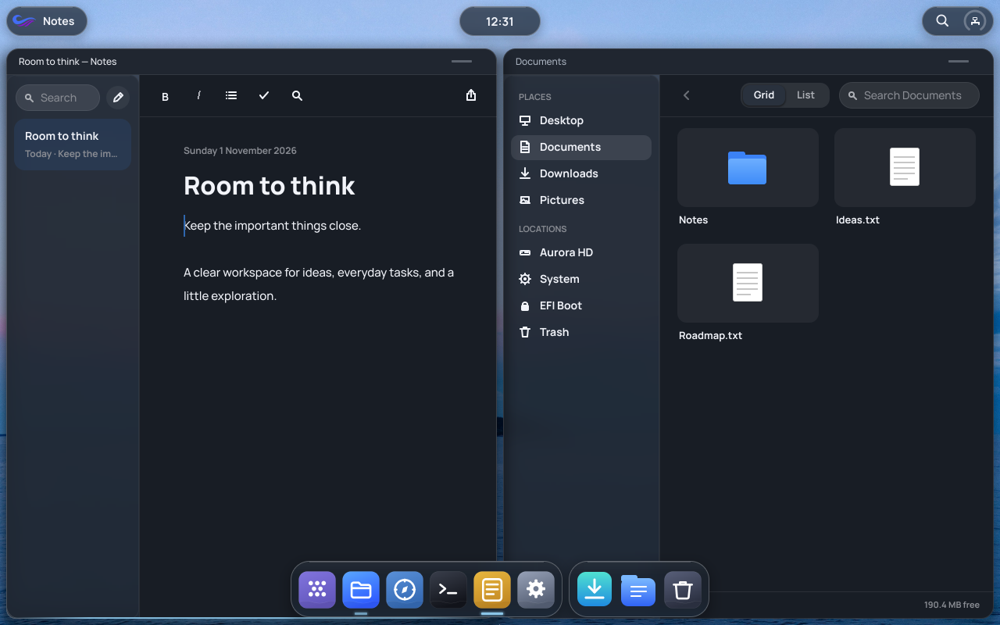

[Get started](#get-started) · [Explore the system](docs/explorer/index.html) · [Read the handbook](docs/handbook/0.7/en/start-welcome.md) · [Every feature](docs/FEATURES.md)

</div>

---

## Beautiful by default.

**Living water**, the WaveOS look: calm light and dark surfaces, floating controls above, and **Harbor** below. A slim strip inside each window quietly reveals its controls when you point at it; every corner and edge resizes with a matching pointer. Six high-resolution photographs bring the desktop to life, with an accent that follows your wallpaper. Shared spacing, typography, rounded cursors, and short transitions carry across the native apps. Welcome’s optional interactive tour gives you a practice window to find your feet. Every word is set in Manrope by **Lyra**, our own TrueType engine.

[See the UI refresh, before/after captures, and native validation](docs/validation/ui-refresh.md).

| | |
|---|---|
| 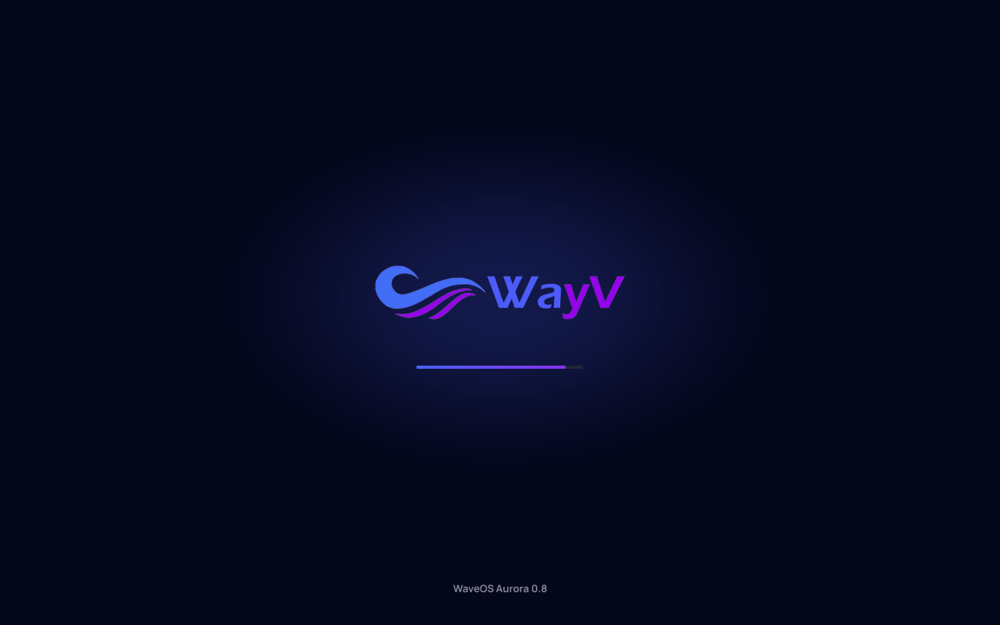 | 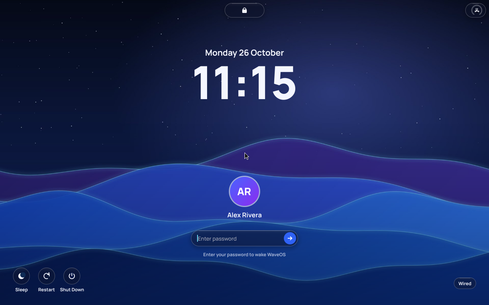 |
| **Start-up.** The WayV logo and real progress, in your appearance. | **Shore.** Your accounts, salted and hashed passwords, and Lock Screen with Super L. |
| 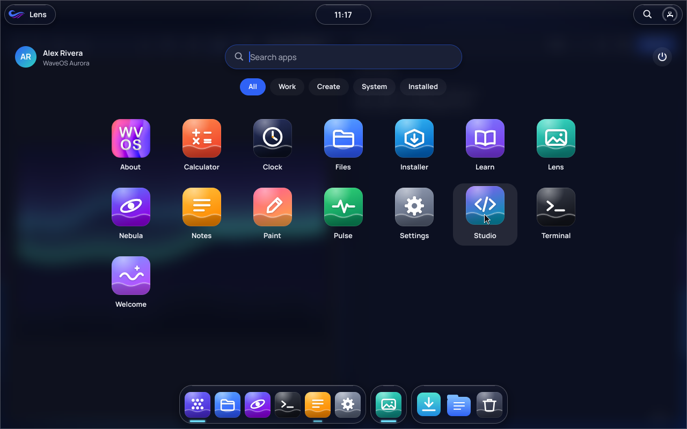 | 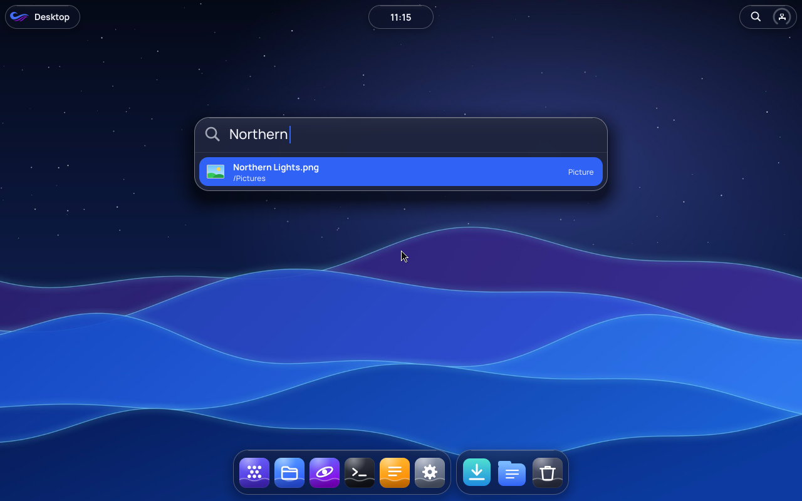 |
| **Shoal.** Every app, full screen. Type to narrow it down. | **Seek.** Apps, files, settings and quick maths, one keystroke away. |
| 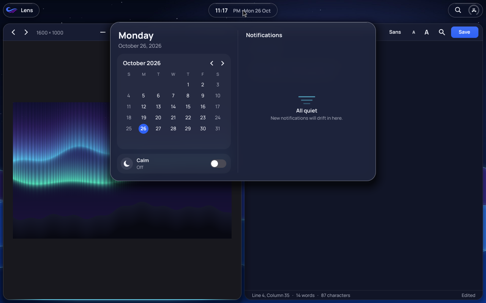 | 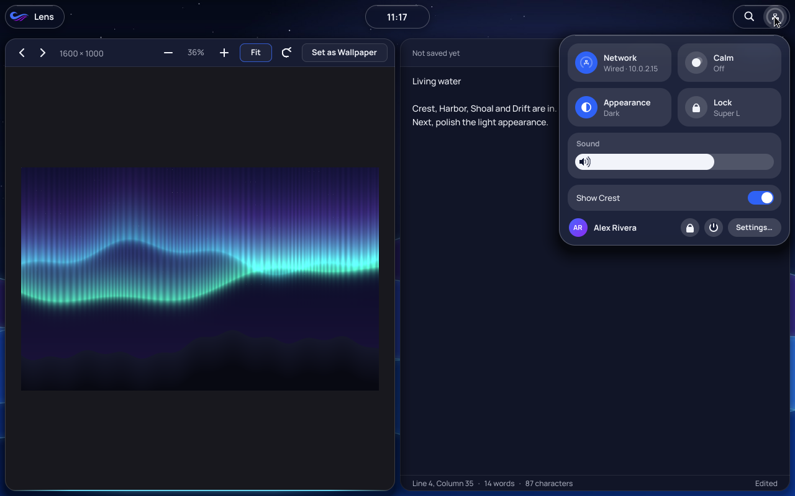 |
| **Drift.** Click Crest for the calendar, Calm and your notifications. | **Current.** The status ring opens the network, Calm, appearance and sound. |
| 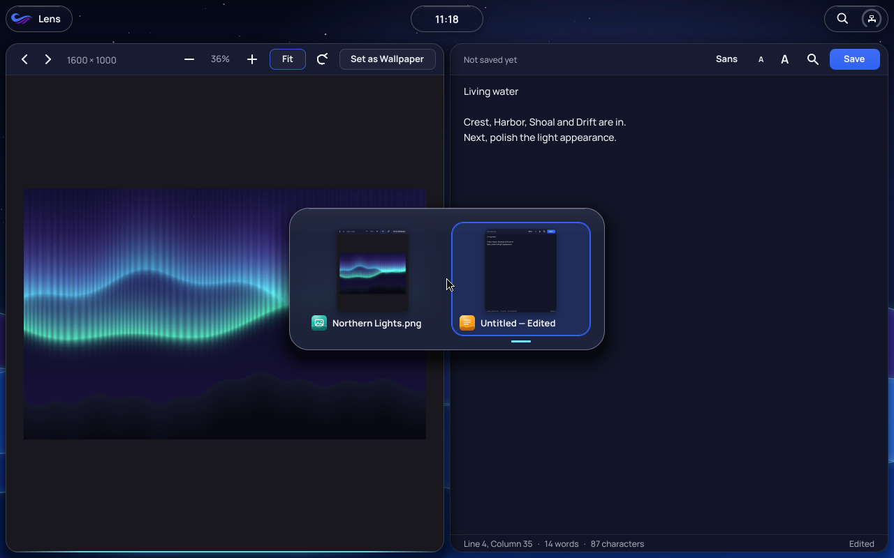 | 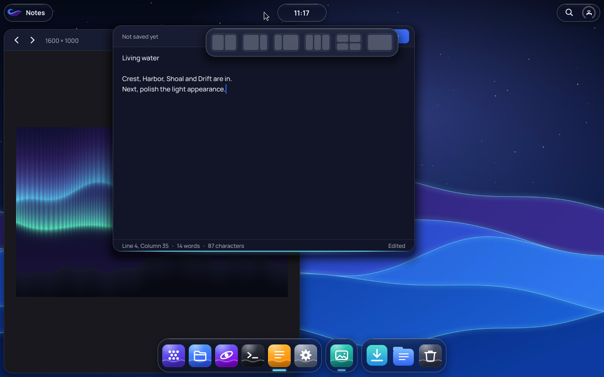 |
| **Glide.** Alt+Tab shows each window as it is. | **Moorings.** Drag a window to the top and drop it into a layout. |
| 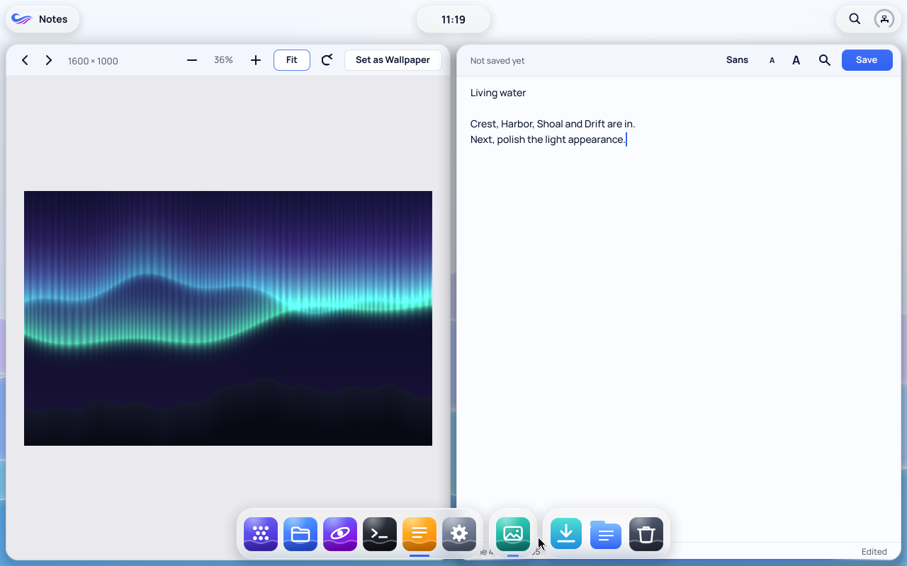 | 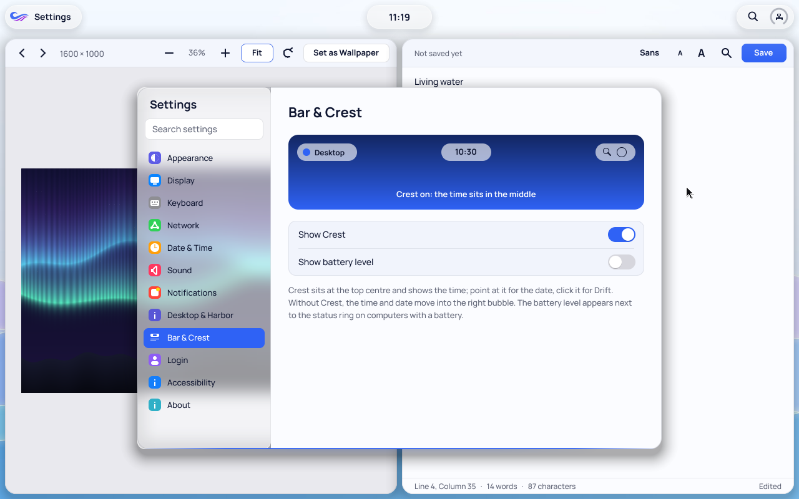 |
| **Light, too.** Every surface, every app. | **Settings.** Turn Crest off, show the battery level, log in automatically. |

**Keyboard shortcuts.** Super (the Windows key) on its own opens Shoal; Super+Space or Ctrl+Space opens Seek; Alt+Tab is Glide. **Super+Tab** or **F3** (or three fingers swept up on a touchpad) opens **Lagoon**, every window spread out side by side: point or use the arrow keys, Enter or a click brings one forward, type to narrow, Escape to go back. Along Lagoon's top are your **Coves**, desktops side by side: **Ctrl+Super+Left/Right** moves between them, add **Shift** to take the front window along, **Ctrl+Super+D** makes a new one and **Ctrl+Super+F4** removes the one you're in (its windows move next door). Super+arrows moor a window, Ctrl+W or Alt+F4 closes it, Super+L locks, Print Screen or Super+Shift+3 takes a screenshot.

## The whole web.

**Voyage** is the browser: our own, around WebKit, the engine of Safari, with JavaScriptCore and WebKit's CSS, running on WaveOS's Linux layer and showing its window through our Wayland bridge. It has tabs, find in page, zoom, persistent site data, useful error/retry controls, and downloads with progress and cancellation. It follows WaveOS's light or dark look. Settings' on-demand connection check separates network configuration from verified DNS and HTTPS access. Mozilla's **Firefox ESR**, unchanged, is a launcher away, and **NetSurf**, a small browser, comes in the system image too. See the [network/browser validation report](docs/validation/network-web.md) for measured results and limits.

| | |
|---|---|
| 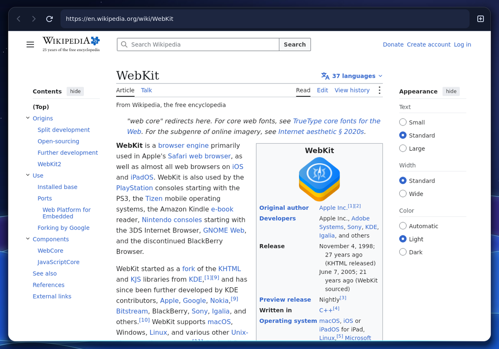 | 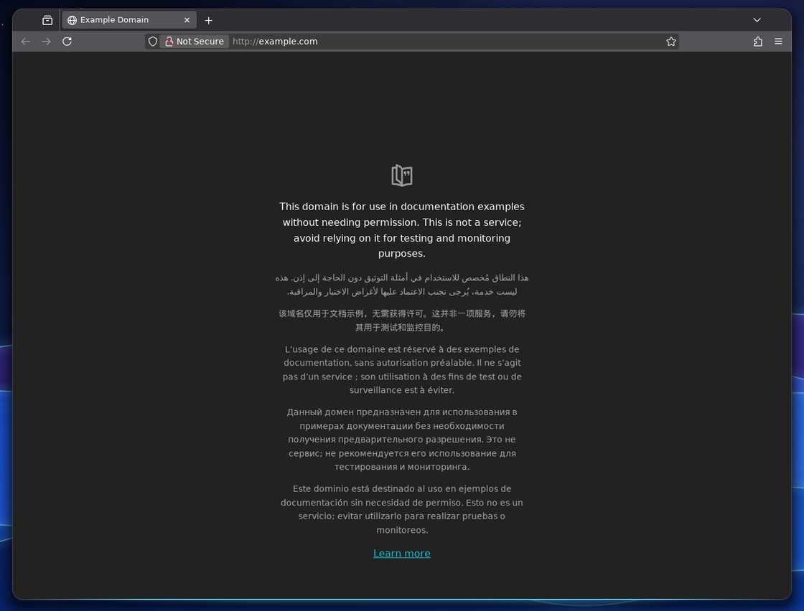 |
| **Voyage.** WebKit, JavaScript and all, quickly. | **Firefox.** Mozilla's engine, unchanged. |

On an Apple-silicon Mac both browsers run on the Arm build at the host processor's own speed: a cold start to a painted page takes two to three seconds, and video plays with sound (H.264, VP9 and AV1 up to 1080p in the playback test, `cargo xtask video-check`). [The measurements](docs/LINUX.md#two-abis-x86-64-and-arm64) say what was timed and how.

## JavaScript, written from scratch too.

**Pulsar** is our own JavaScript engine: a compiler, a virtual machine, a garbage collector, and core standard-library facilities, from classes and generators to `async`/`await` and regular expressions. It passes more than 34,000 of the official conformance tests. In Terminal, type `js` and start writing: `js` for a prompt, `js file.js` to run a file.

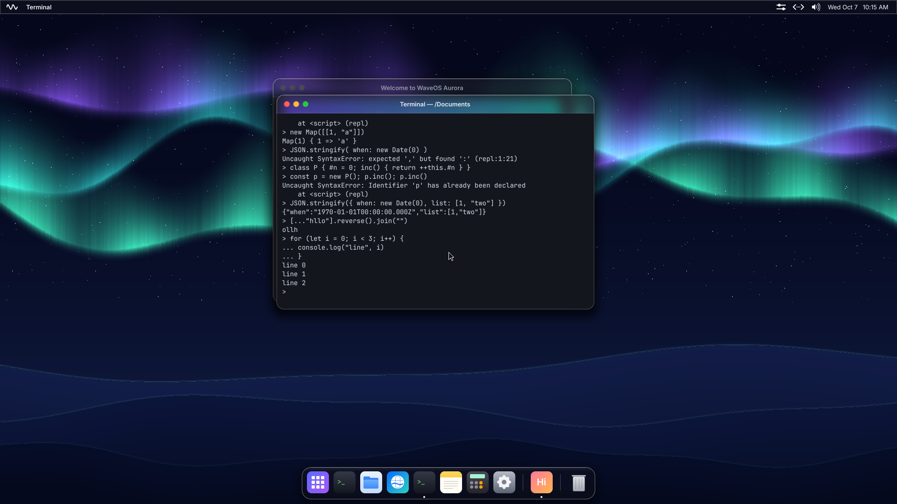

## Every app in its own world.

Each app runs as a separate, protected process. If one crashes, you see a polite "quit unexpectedly" — and everything else keeps right on working. Run out of memory and it keeps going too: pages you haven't touched in a while are compressed, then moved to an encrypted swap file, and come back the moment you need them. Your files live on **AuroraFS**, a journaled filesystem built to survive a power cut.

| | |
|---|---|
| 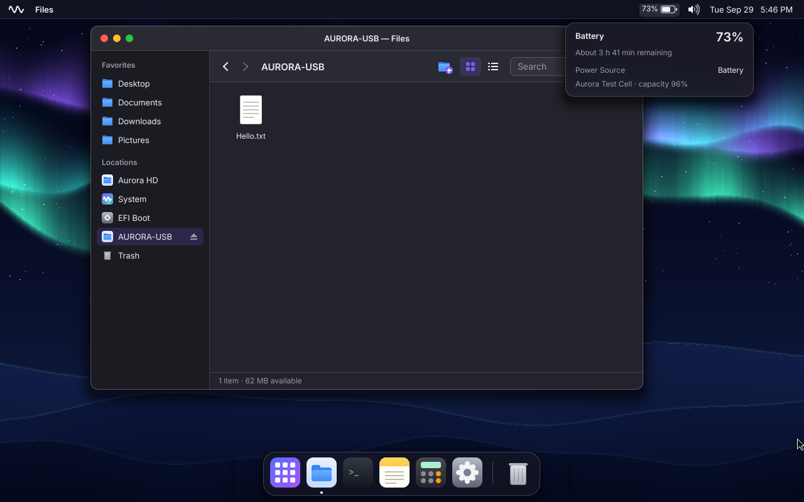 | 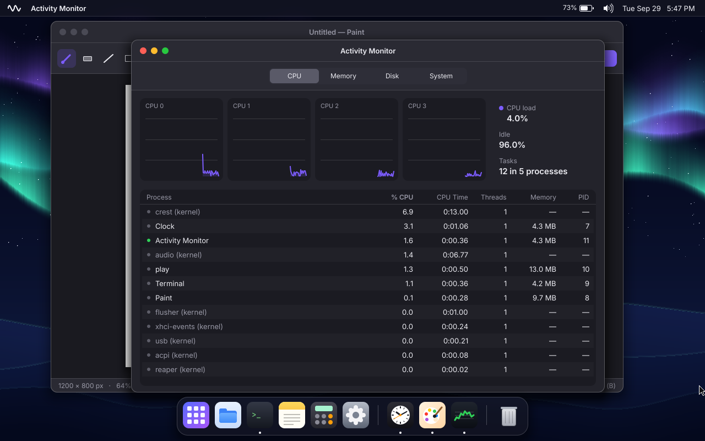 |
| **Files.** Drag and drop, Quick Look, thumbnails, a Trash with Put Back, and USB sticks that just appear. | **Pulse.** Every process, every core, every byte — live. |

## Made for real machines.

Multicore scheduling with tickless idle. USB 3, with USB audio. NVMe, SATA, SD cards and eMMC. Sound with headphone detection. Battery, lid and sleep. Wired networking on Intel and Realtek adapters, ready the moment you boot. Several monitors, each at its own resolution and scale, arranged in Settings. Accounts with file permissions, signed installable apps, and a kernel hardened with ASLR, guarded stacks and W^X.

Display drivers for Intel and AMD graphics, laptop touchpads over I²C, and other drivers written from specifications have so far run only against simulated hardware; [HARDWARE.md](docs/HARDWARE.md) says exactly what has been tested where, and what to send back if you try a real PC.

| | |
|---|---|
| 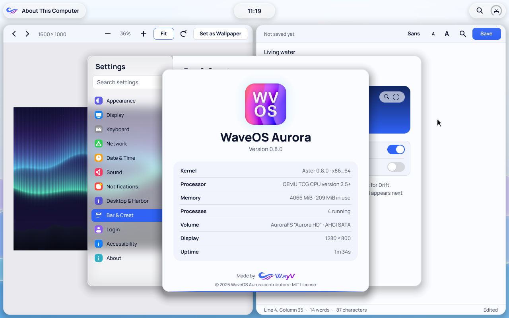 | 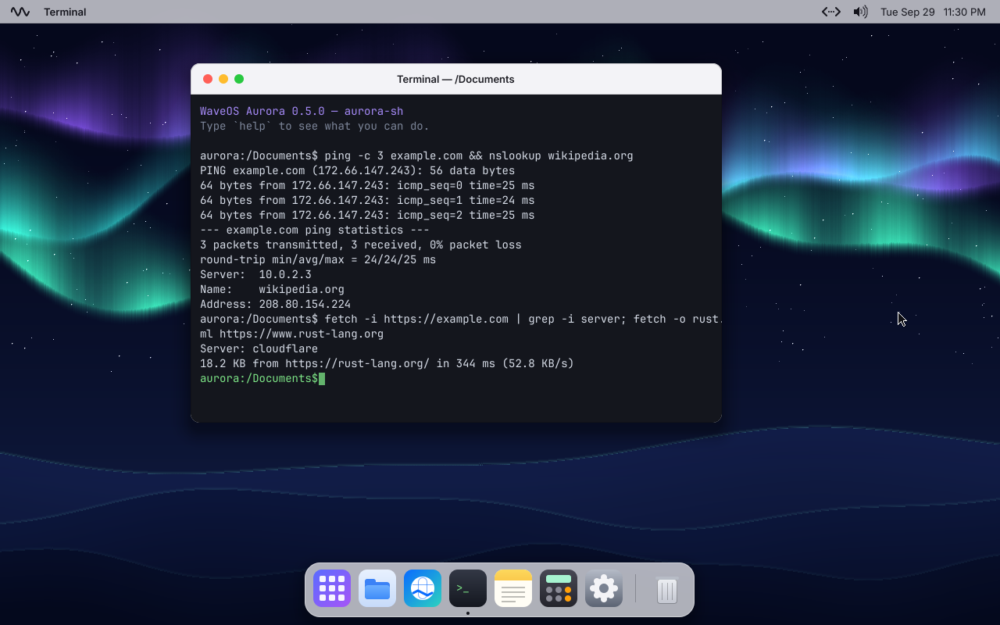 |
| **About This Computer.** The WVOS mark, the version and the machine. | **Terminal.** A real shell, with pipes, redirection and 35 programs. |

## Ready to play.

Connect a controller and the desktop becomes **Wave Play**: a console-style home for your games and apps, with a quick overlay on the home button, and the desktop back the moment you want it.

Underneath, Linux games find what they expect. WaveOS's own display drivers speak Linux's DRM/KMS interface at `/dev/dri/card0`, and keyboards, mice and controllers appear as standard `evdev` devices, so unmodified libdrm and SDL2 programs run as they are. Mesa runs unmodified on top, so OpenGL and Vulkan programs draw today in software (llvmpipe and lavapipe), in windows without a copy. **Doom** is in the box: the left mouse button, X or Ctrl fires, and its window resizes and maximizes with the picture. Hardware-accelerated 3D is the work in progress: see the [roadmap](docs/ROADMAP.md).

## See inside, while it runs.

The **System Explorer** is a live map of the whole OS. Watch it boot, see each CPU's scheduling decisions, and click any part to see what it's doing and the source code behind it.

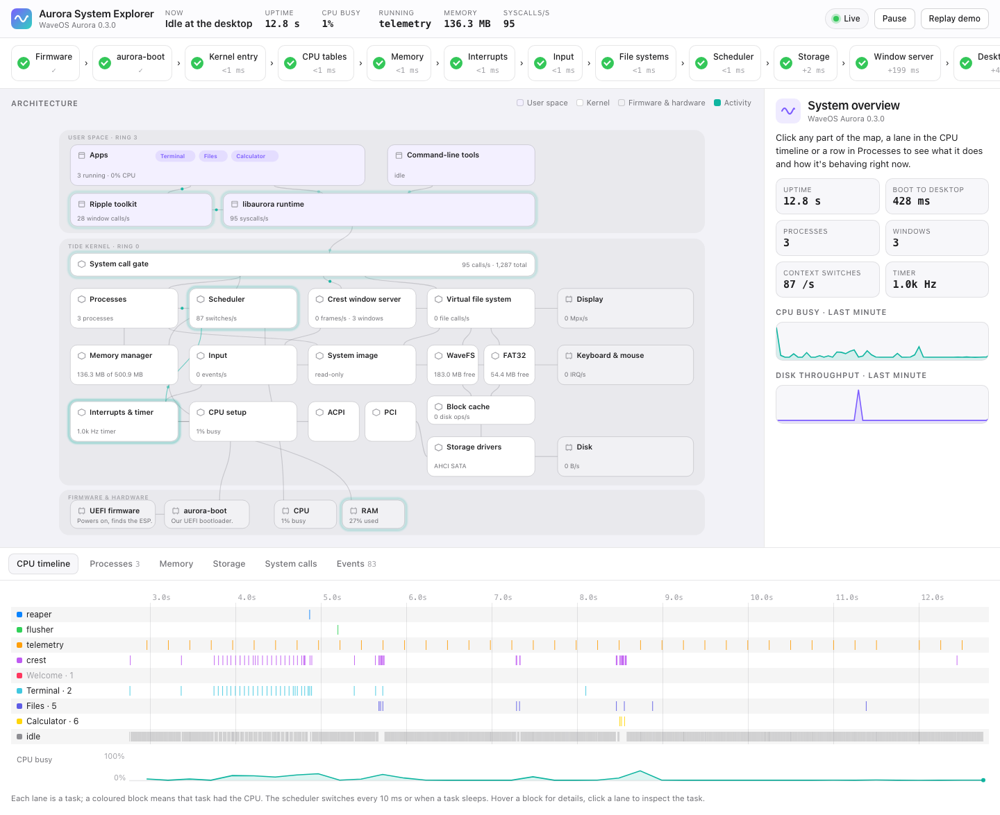

---

## Get started

You need a Mac (Apple silicon or Intel) or a Linux PC, [rustup](https://rustup.rs) and QEMU (`brew install qemu`, or `sudo apt install qemu-system-x86 ovmf`, plus `qemu-system-arm qemu-efi-aarch64` on an Arm PC).

```sh
git clone https://github.com/Sw3bbl3/waveos-aurora-rs.git
cd waveos-aurora-rs
make run
```

`make run` (or `./waveos` without make) opens the launcher in your browser: pick a preset or choose the displays, memory, devices and so on, then press Launch. The build output and the serial console stream into the page. `make quick` boots whatever you launched last, and `make` on its own lists the other shortcuts. Prefer the terminal? `cargo xtask run` does the same with the defaults.

A minute later, you're at the desktop. Add `--monitor` to open the System Explorer alongside it.

**Which processor.** WaveOS runs on 64-bit Arm and on x86-64, and by default on your computer's own where QEMU can run it at full speed: on an **Apple-silicon Mac** that is Arm, under Hypervisor.framework, many times faster than the x86-64 build, which QEMU emulates instruction by instruction there. On an x86 PC it is x86-64. The other one is always a choice away: `make run ARCH=x86_64` (or `ARCH=aarch64`), `cargo xtask run --arch x86_64`, or the **Chipset** card at the top of the launcher, which shows both with the board each boots on and whether it runs at full speed here.

**Each processor has its own disk** (`target/waveos-aurora-aarch64.img` for Arm, `target/waveos-aurora.img` for x86-64). The first Arm run makes a new one and never touches the x86 disk; if you have used WaveOS on x86 before, it says so, and `cargo xtask migrate-disk --arch aarch64` copies your files across, reading the x86 disk only ([BUILDING.md](docs/BUILDING.md#two-architectures-x86_64-and-aarch64)). The first run also fetches Debian's packages for the Linux programs (Voyage, Firefox ESR…) and says how much it downloads (about 1.9 GB for Arm, once); `--no-linux-root` leaves them off. How the port works: [porting.md](docs/developer/porting.md). To try a real PC, see [HARDWARE.md](docs/HARDWARE.md); for every build command, see [FEATURES.md](docs/FEATURES.md#build-commands).

## Under the hood

| | |
|---|---|
| **Firstlight** | UEFI bootloader |
| **Aster** | Hybrid kernel: multicore, ACPI, sleep and resume |
| **AuroraFS** | Journaled, extent-based filesystem |
| **kswapd** | Memory reclaim: compressed memory (our own LZ4), an encrypted swap file, and an out-of-memory killer that spares the app you're using |
| **Lumen Server** | Compositing window server |
| **WaveUI** | Declarative interface framework every app is built with ([WaveSDK](docs/WAVESDK.md)) |
| **AuroraKit** | Windowing toolkit WaveUI runs on |
| **Lyra** | TrueType font engine |
| **Nebula Engine** | HTML, CSS and layout for Learn; HTTP and TLS for `fetch` and apps |
| **Pulsar** | JavaScript engine: compiler, VM, collector, DOM — [status](docs/PULSAR.md) |

Nearly everything is our own. Where we stand on others' shoulders, we say so: cryptographic primitives come from [RustCrypto](https://github.com/RustCrypto), ACPI's AML interpreter from the [`acpi`](https://crates.io/crates/acpi) crate, and maths functions from [`libm`](https://crates.io/crates/libm). The browsers are [Firefox ESR](https://www.mozilla.org/firefox/enterprise/) (MPL-2.0, Debian's build, on the disk with the [Linux programs](docs/LINUX.md)) and [NetSurf](https://www.netsurf-browser.org/) (GPL-2.0, [how it is built](docs/NETSURF.md)), shipped as separate programs.

Go deeper: [Architecture](docs/ARCHITECTURE.md) · [Every feature](docs/FEATURES.md) · [Roadmap](docs/ROADMAP.md) · [Building and debugging](docs/BUILDING.md) · [Validation](docs/VALIDATION-2026-09-30.md) · [Contributing](CONTRIBUTING.md)

## License

Code under the [MIT License](LICENSE). Manrope and JetBrains Mono under the SIL Open Font License.

Native H.264/AAC media decoding uses licensed third-party Rust components. See [third-party notices](THIRD_PARTY_NOTICES.md) for attribution and fixture provenance.
