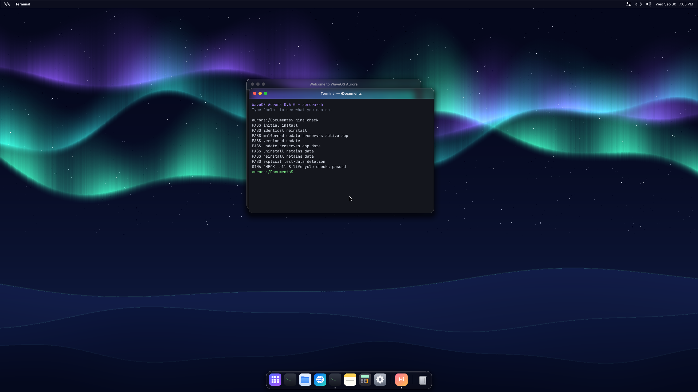
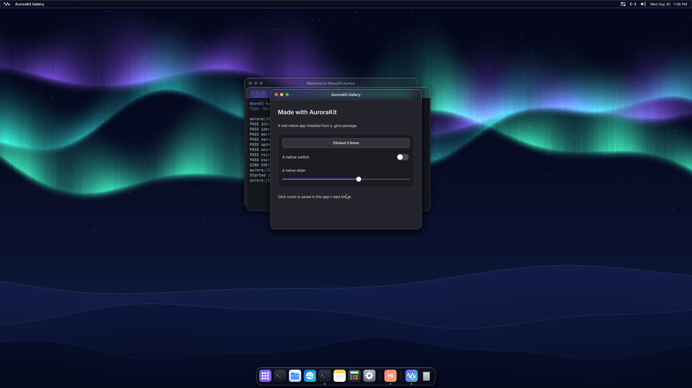
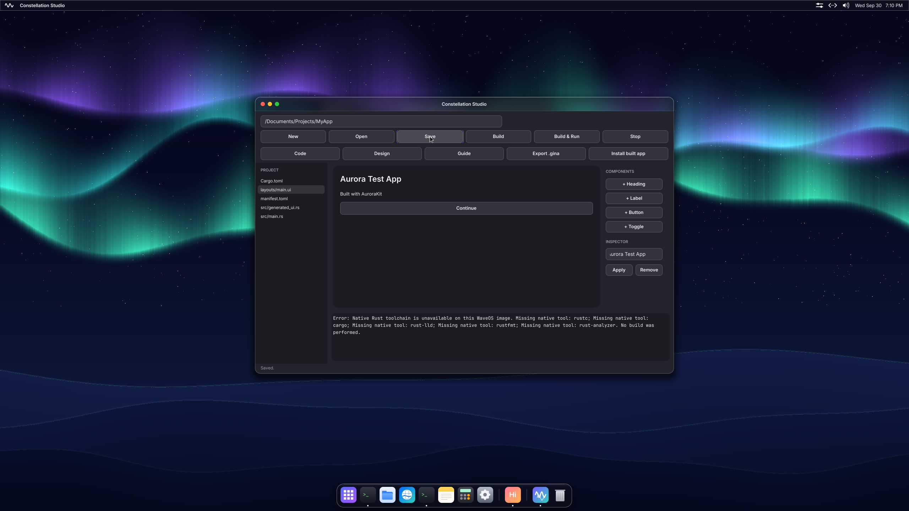
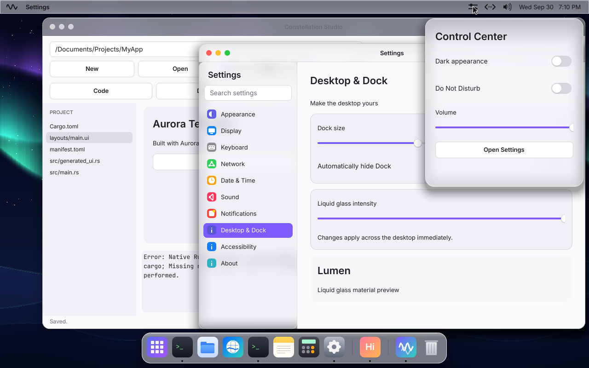
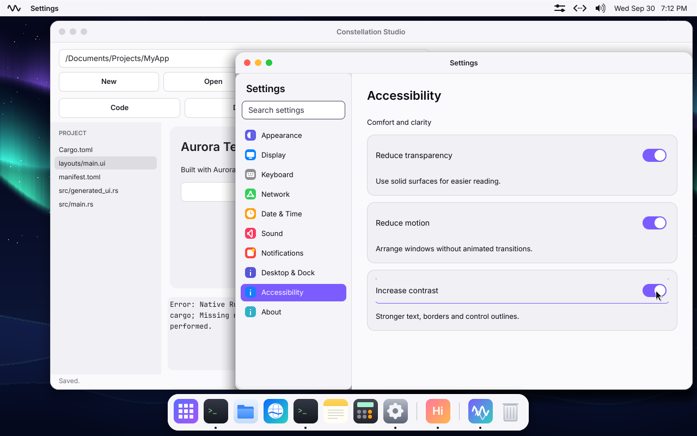
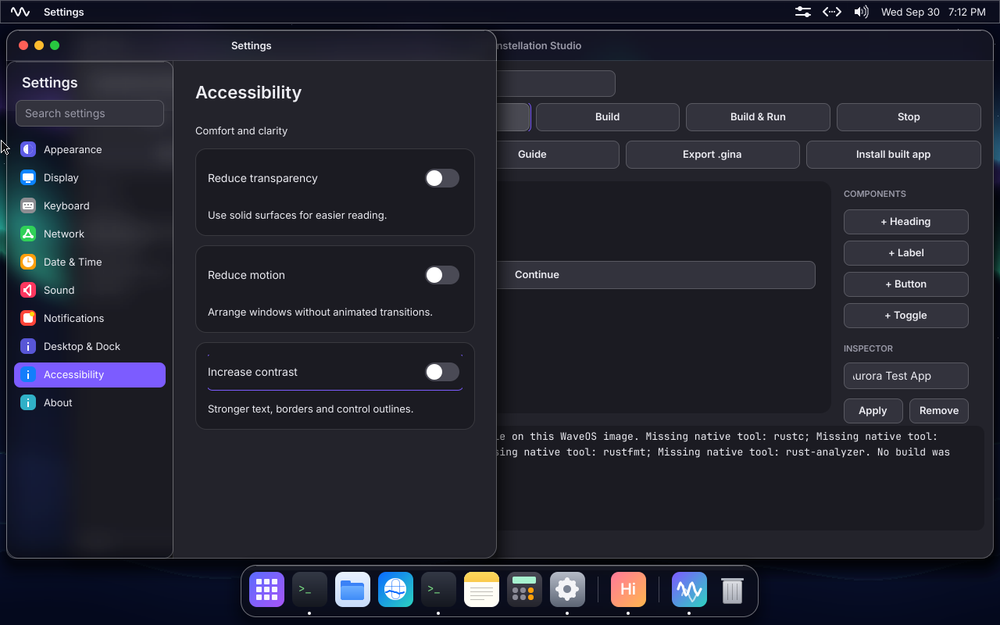
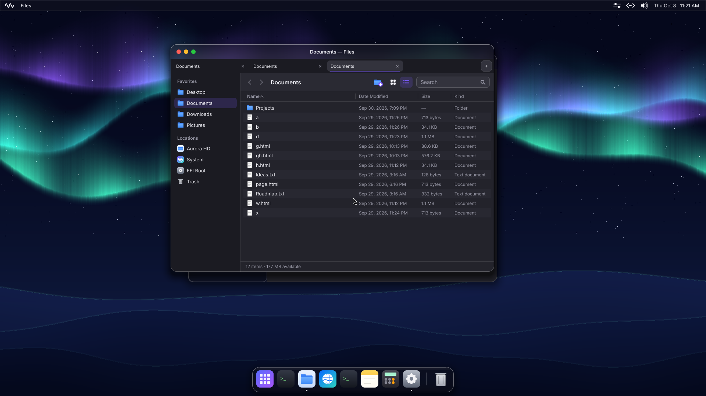
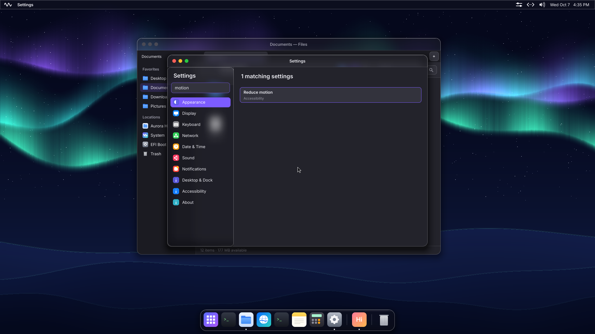
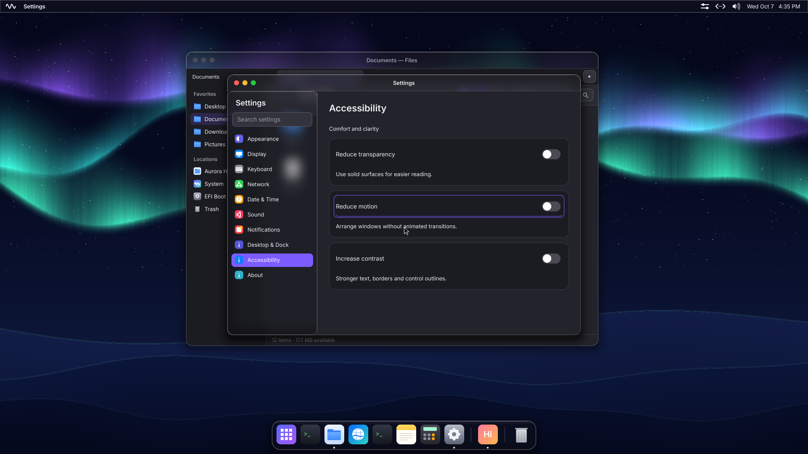

# Aurora / Constellation validation — 2026-09-30

This records executed checks, not completion of the full product plan. The compiler port and native source debugger remain unimplemented, so the final offline Studio build/debug acceptance **does not pass**.

## Build and regression checks

| Check | Observed result |
|---|---|
| `cargo xtask build` | Pass, including Aster, FirstLight and the complete native application workspace |
| `cargo test -p lumen -p gina -p xtask -p aurorafs` | 24 tests passed |
| `cargo xtask test` | 31 kernel tests passed on each of two boots; persistence verified; recorded audio peak 4319 |
| `git diff --check` | Pass |
| Original `kernel/src/tests.rs` changes | All four pre-existing network diagnostic log lines retained |
| Existing desktop disk | Booted and updated in place; original settings/user data retained; APFS-clone backup at `target/waveos-before-constellation.img` |

Logs: `target/final-unit-tests.log`, `target/final-kernel-tests.log`, `target/optimized-build.log`. The system archive is about 11 MiB. This is not a measurement of native toolchain size; no native toolchain is bundled.

## On-device GINA checks

With QEMU networking disabled (`--net none`), the native `gina-check` program exercised:

1. Initial validated installation.
2. Identical package reinstallation.
3. Rejection of a malformed update, keeping the active app unchanged.
4. Selection of a new versioned payload.
5. App-data retention through update.
6. Uninstall while retaining app data.
7. Reinstall while retaining app data.
8. Explicit deletion of the test app and its test data.

All eight passed. The test uses a unique app ID and leaves the user's gallery/data alone. Separately, the gallery was installed, launched as a real process, interacted with, then reopened after restarting QEMU. Its counter remained **3**.

Opening the `.gina` through the desktop file-opening path presented update details in GINA Apps. Clicking Update completed successfully; Open App launched the updated generation with the same saved counter.

The gallery executable is host-precompiled when assembling the image. These results verify installation and execution, not native Rust compilation. Host-side GINA tests also exercise traversal, duplicate/unsupported metadata, links, checksums, resources and ABI rejection. Power-cut injection during installation, full-disk update rollback, and malicious compositor-region syscall tests remain to be added.

## Desktop and Studio checks

- Inspected light and dark appearances at 2560×1440 and 1280×800.
- Changed resolution live and accepted the confirmation dialog.
- Exercised live Reduce Transparency, Reduce Motion and Increase Contrast; restored them afterward.
- Inspected real background content blurring behind the Settings sidebar and Control Center.
- Dragged Settings to the left edge, inspected the snap preview, and confirmed the snapped layout.
- Created `/Documents/Projects/MyApp` in Studio, opened the generated Rust source, switched to Design, changed the heading through the property inspector to “Aurora Test App”, and saved.
- Pressed Build & Run and observed the explicit missing-native-toolchain error. No replacement executable was installed.

These are sampled interaction checks, not exhaustive validation of every layout, focus path, resize edge or material clipping case. The Settings search currently returns matching pages; fully indexed individual-setting navigation remains incomplete.

## Host keyboard capture

The first interactive Cocoa launch reported `Could not create event tap, system key combos will not be captured`. After the user enabled QEMU Accessibility and QEMU restarted, that warning disappeared. The configured display backend is `cocoa,full-grab=on,left-command-key=on,swap-opt-cmd=off`; release is Control+Option+G.

The native computer-control interface could not select Homebrew's standalone QEMU executable. A physical-keyboard confirmation of Command+Space, Command+Tab and release was requested but has not been received. QMP checks do not establish host interception.

## Rendering measurements

Measured using QEMU 11.1.1 on the Apple Silicon host, x86_64 guest, four virtual CPUs and 512 MiB RAM. Lumen's counters time scene composition plus framebuffer flush; they exclude client-side drawing and are not end-to-end input-latency measurements.

| Final image sample | Frames | Mean | Maximum |
|---|---:|---:|---:|
| Cocoa, 1280×800, initial desktop | 8 | 32 ms | 39 ms |
| Cocoa, 1280×800, opening Settings | 14 | 42 ms | 71 ms |
| Cocoa, 2560×1440, Settings and resolution confirmation | 10 | 61 ms | 84 ms |
| Headless, 1280×800, Studio and Settings open | 11 | 51 ms | 72 ms |

Logs: `target/aurora-final-session.log` and `target/material-performance.log`. These are small interaction samples with different scene contents, not controlled before/after benchmarks. They do **not** establish 60 fps. Scene reconstruction, software shadows, and backdrop dependency tracking still need optimization. Improvements in this branch include reusable blur buffers, cached finished materials, coarser moving-window samples, cursor-only scene reuse, and elimination of the Settings idle repaint loop.

## Outstanding final acceptance

Native Rust/Cargo/LLVM execution, a complete offline sysroot/dependency bundle, build scripts/procedural macros, rust-analyzer/rustfmt, kernel process-debug controls, source breakpoints/stepping/variable inspection, and Studio debugger integration remain outstanding. The complete offline create → design → build → install → run → debug → export → reboot sequence has not been achieved.

## Everyday-use update — 2026-10-08

This milestone adds eight session-only Files tabs, one window-owned background transfer worker with a 64 KiB buffer, explicit conflict decisions, cancellation/close cleanup, and bounded thumbnail caching. Search workers are debounced, cancelled when inactive, and joined. Settings indexes 24 exact controls with keyboard navigation, reveal/focus/highlight, and `pane/control` launch destinations. AuroraKit has an optional absolute wakeup deadline; unchanged apps retain `tick_interval`. Desktop clock, notification expiration, volume HUD, focus and animation work now determine its deadlines. Existing glass, shadows, motion preferences and filesystem/settings formats remain compatible.

### Preservation and delivery

The baseline includes the user's existing Nebula work, not just Git HEAD. Before this milestone, the dirty source tree and disk were preserved in `target/everyday/source-before.tar.gz`, `diff-before.patch`, `status-before.txt` and the APFS clone `disk-before.img`. All runtime checks used cloned disks. The original `target/waveos-aurora.img` was not used as a validation target. The updated kernel and system archive are built in `target/esp`; `cargo xtask run` launches the local update. No release or remote publication was performed.

### Executed checks

| Check | Result |
|---|---|
| Full `cargo xtask build` | Pass |
| `cargo test -p nebula-engine -p aurorafs -p lumen -p xtask` | 76 tests passed, including 45 Nebula regressions |
| Production transfer module with host I/O/fault adapter | 12 tests passed: partial/zero writes, full disk, conflict choices/apply-all, folder conflict restrictions, cancellation, retained completed items, cleanup failure, cross-volume moves, pre/post-publication sync failures, worker exclusivity and path guards |
| `cargo xtask test` | 33 kernel tests passed on each of two boots; persistence, sound capture and bilingual Learn checks passed |
| Native Files `--self-check` | Tab isolation, 50 search/cancel cycles after 10 warmups, verified 64 MiB copy, real AuroraFS-to-FAT32 move, cancellation and asynchronous close passed |
| Native Settings `--self-check` | 24 unique indexed controls and deep links passed |
| Interactive QMP checks | Tab limit/shortcuts/closure, list/icon view, conflict Keep Both and completion, Settings search/reveal, light/dark and accessibility modes exercised |
| Stationary Notification Center | Zero scene frames during a 12-second idle sample after its opening animation |

Guest resource checks on the final Files executable: search-cycle memory **2588 → 2588 KiB**, threads **1 → 1**; copying **67,108,864 bytes** used a sampled process peak of **2844 KiB**, **256 KiB** above its 2588 KiB starting level. Samples are every 20 ms; the production copy buffer is independently fixed at 64 KiB. This bounds the file-copy buffer and measures process memory, not every kernel filesystem cache allocation. Thumbnail accounting includes pixel capacity, path capacity, failed-decode entries and conservative map overhead within a 12 MiB budget.

Logs remain in `target/everyday/candidate/`: `build-final.log`, `host-tests-final.log`, `transfer-tests.log`, `kernel-tests-final.log` and `1280-release.log`. The build reports the existing sha2 future-compatibility warning.

### Interrupted replacement on a disposable disk

`tools/test_files_powercut.py target/everyday/powercut.img` passed all three prepare/stop/reboot/verify pairs. QMP quit stopped the guest without requesting guest filesystem synchronization. A 64 KiB destination recovered complete **old** contents when stopped before publication, complete **old** contents after rename but before explicit sync, and complete **new** contents after publication and sync. Known fixture files were removed after successful verification. [Recorded outcomes](measurements/everyday-2026-10-08/powercut.json).

These exercise the production AuroraFS rename/sync publication protocol on an actual cloned QEMU disk, plus host AuroraFS fault-injection tests and transfer-worker fault tests. They do not cover every possible torn device write, concurrent source mutation, or transactional replacement on FAT32. Cross-volume source deletion waits for successful destination synchronization; a power failure can still leave recoverable staging data or both copies. The original persistent disk was byte-for-byte equal to `disk-before.img` after validation.

### Repeated performance measurements

QEMU **11.1.1**, x86_64 software emulation on an **Apple M2 / 16 GiB Mac**, four guest CPUs, **512 MiB** guest RAM, headless display, networking and sound disabled. Each run opens Files/Documents and Settings/Appearance, performs one warmup followed by **five repetitions** of 22 seconds idle and two Alt+Tab switches. Each resolution uses identical guest configuration before/after. Static caret-free samples are selected from complete ten-second counter intervals; all final datasets have zero excluded clock discontinuities.

| Resolution / measure | Baseline | Update |
|---|---:|---:|
| 1280×800 Files idle wakeups/second | 9.956 | 0.500 |
| 1280×800 Settings idle wakeups/second | 9.948 | 0.500 |
| 1920×1080 Files idle wakeups/second | 9.955 | 0.500 |
| 1920×1080 Settings idle wakeups/second | 9.951 | 0.500 |
| 1280×800 switching composition median / p95 | 54 / 77 ms | 58 / 86 ms |
| 1920×1080 switching composition median / p95 | 84 / 110 ms | 85 / 117 ms |
| 1280×800 sampled guest CPU busy, normalized across four CPUs | 1.513% | 1.176% |
| 1920×1080 sampled guest CPU busy, normalized across four CPUs | 1.371% | 1.237% |
| Median guest used memory, both resolutions | 151,576,576 bytes | 151,764,992 bytes |
| Maximum guest task count, both resolutions | 10 | 10 |

Idle wakeups fell **94.97–94.98%**. Each Files run contributes eight completely idle counter samples; Settings contributes seven baseline and six updated samples. CPU figures have only five baseline/four updated usable pairs per resolution and vary with host load; they do not establish a general CPU-saving percentage. Updated idle process memory is 8732 KiB for Files and 8596 KiB for Settings, with one thread each. Baseline process counters were unavailable; aggregate guest memory increased **184 KiB**, so this work does not claim lower total idle RAM.

**Frame-time investigation:** initial 1080p runs showed 57 → 82 ms median; rerunning the unchanged baseline under the later host load produced 84 ms. Consecutive comparisons yielded 84 → 85 ms. The final 1280×800 p95 still increased **11.7%** (77 → 86 ms); median increased 7.4%. The runs have comparable full-screen damage/frame counts, without search-caret animation. Files' default window grew from 880×540 to 880×580 for its tab row, and host load was not isolated. The exact cause of the remaining tail regression is not isolated; it remains a measured limitation. This milestone reduces idle scheduling and copy buffering, and does **not** establish faster rendering, end-to-end input latency or a fixed frame rate.

Reproducible source data: [1280 baseline](measurements/everyday-2026-10-08/baseline-1280.json), [1280 update](measurements/everyday-2026-10-08/candidate-1280.json), [1280 summary](measurements/everyday-2026-10-08/summary-1280.json), [1920 baseline](measurements/everyday-2026-10-08/baseline-1920.json), [1920 update](measurements/everyday-2026-10-08/candidate-1920.json), [1920 summary](measurements/everyday-2026-10-08/summary-1920.json). Re-run with `tools/benchmark_everyday.py` and compare with `tools/summarize_everyday.py`. Earlier exploratory logs and the invalid-launch/clock-jump runs remain in `target/everyday` and are not mixed into these final datasets.

### Screenshots and guidance

Additional captures: [transfer conflict](screenshots/everyday/transfer-conflict.png), [light appearance](screenshots/everyday/light.png), [accessibility preferences](screenshots/everyday/accessibility.png), [stationary Notification Center](screenshots/everyday/notification-center.png).

Files, Settings and app-development handbook pages were updated in English and Canadian French and included in the built offline Learn archive. Existing Nebula improvements and regression tests are preserved; broader YouTube compatibility and hardware drivers remain outside this milestone.

## Web milestone — 2026-10-10

Nebula tabs that keep working in the background, comment nodes, TreeWalker/NodeIterator, a live MutationObserver, getComputedStyle from the cascade, `<style>` elements added by scripts, a 2D canvas with paths/gradients/text/images, image load events, faster page loading, an HTTP and DNS cache, a size-class userland allocator, and IPv6 in the kernel and corekit.

### Executed checks

| Check | Result |
|---|---|
| `cargo test -p nebula-engine -p nebula-web -p nebula-script -p lumen -p aurorafs` | All passed (engine: 28 script, 14 layout, 5 stylesheet tests; web: 15 including a 304-with-Content-Encoding regression) |
| Glyph masks before/after Lyra's public `Coverage` | 137,106 masks hashed, identical |
| test262 before/after the method-name binding fix | 34,415 → 34,417 passing, no new failures |
| `cargo xtask test`, both boots | All passed, including new IPv6 tests: SLAAC (`fec0::5054:ff:fe12:3456/64` via `fe80::2`), ICMPv6 echo to `::1`, link-local, global and the gateway, UDP and TCP over `::1`, 1 MiB from the host over IPv6 through QEMU. The known ACPI interpreter panic appears as in earlier logs. |
| `Nebula.elf --self-check` | Pass: isolation, background load, storage event, timers (3 runs in 2.5 s behind, 94 in 1 s in front), 200 switches with no memory or thread growth, eight-tab limit |
| Browser checks page in the guest | 8 of 8 PASS |
| `ifconfig`, `ping fec0::2`, `nslookup wikipedia.org` in Terminal | IPv6 addresses and router shown; replies 0–6 ms; AAAA and A records returned ([screenshot](screenshots/ipv6-terminal.png)) |

IPv6 was validated only against QEMU's user network. The test host has no IPv6 route to the internet, so real-site IPv6 isn't measured. Corekit uses IPv6 for internet destinations only from a global unicast address (2000::/3), so QEMU's site-local `fec0::/64` falls back to IPv4 at once.

### Page loads

QEMU x86_64 software emulation on an Apple M2, four guest CPUs, 512 MiB, real sites over QEMU's NAT. `tools/benchmark_web.py` loads each site once cold, then again after the others (warm). "Total" runs from the start of the load to the end of the page's scripts and first layout; "paint" is when the page was first laid out and shown. In the baseline those were the same moment. One run each, and network time varies run to run.

| Site | Baseline total | Now: paint / total (cold) | Now total (warm) |
|---|---:|---:|---:|
| example.com | 768 ms | 512 / 662 ms | 506 ms |
| Wikipedia (Rust article) | 2,171 ms | 1,020 / 1,655 ms | 1,772 ms ¹ |
| Hacker News | 5,881 ms ² | 876 / 942 ms | 426 ms |
| text.npr.org | 1,225 ms | 566 / 569 ms | 496 ms |
| lite.cnn.com | 2,056 ms | 412 / 592 ms | 519 ms |
| rust-lang.org | 1,394 ms | 483 / 598 ms | 1,025 ms |
| gnu.org | 1,251 ms | 8,319 / 8,414 ms ³ | 2,141 ms |
| DuckDuckGo HTML | 1,737 ms | 958 / 977 ms | 856 ms |
| MDN | 1,576 ms | 296 / 433 ms | 798 ms |
| GitHub repository | 5,262 ms | 1,071 / 1,448 ms | 1,748 ms |
| BBC News | 118,813 ms | 317 / 5,775 ms | 5,762 ms |

¹ Measured in a separate revisit after fixing a 304 revalidation bug that made the benchmark's warm Wikipedia visit fail. ² The baseline figure includes work left over from the previous page (Wikipedia), which the old page no longer gets to do. ³ The TLS handshakes to gnu.org took 7.5 s that run; the warm run took 2.1 s, so this looks like the network, not the browser.

Most of the difference came from four fixes: the previous page's timers, image events and relayouts no longer run while the next page loads; image arrivals no longer force a full relayout each; timers wait until the page's own scripts have run; and page scripts run in slices, so input stays responsive. Downloads in parallel and painting before scripts mainly bring the first paint forward. Data: [baseline](measurements/web-2026-10-10/baseline.json), [final](measurements/web-2026-10-10/final.json), and their timing lines. The baseline's warm pass is unusable: the harness, since fixed, credited BBC's late result to the next site.

Not measured or not done: HTTP/2, TLS session resumption, incremental layout, and running page scripts off the UI thread. A heavy page's own timers can still keep the window busy.
