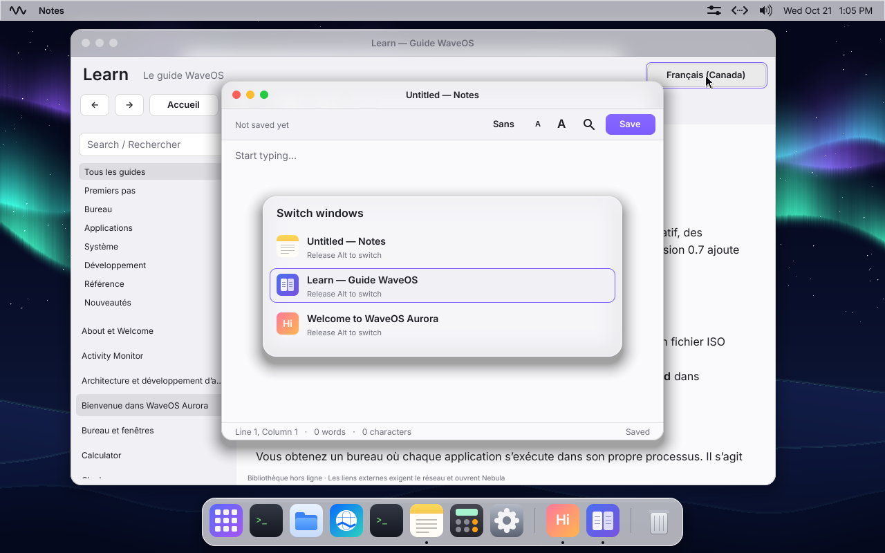

# Desktop and windows
Arrange your workspace with Harbor (the dock), Apps, and the window controls. Welcome offers an optional interactive tour with a practice window. Replay it from Help or the WayV menu.

## Open and arrange apps
1. Click Apps in Harbor, type an app name, and press Enter.
2. Point at the slim strip inside the top of a window to reveal its controls. Drag this strip to move the window. Drag any edge or any of its four corners to resize; the pointer shows the direction.
3. Drag a resizable window to the left or right screen edge to preview a split layout. Release to snap. Drag to the top to maximize.
4. Drag a snapped window’s top strip away to restore its floating size.

The controls appear inside the window: minimize (a line), maximize/restore (a square), and close (an ×). They never cover or shift your content. Alt+Space focuses them; use Tab or the arrow keys, Enter to activate, and Escape to return to the app. Apps can prompt before closing unsaved work.

## Switch windows
Hold Alt and press Tab to open the window chooser. Press Tab again to advance, or Shift+Tab to reverse. Release Alt or press Enter to select. Escape cancels. Minimized windows appear in the chooser and restore when selected.

| Shortcut | Action |
|---|---|
| Super+Left / Right | Snap left / right |
| Super+Up | Maximize |
| Super+Down | Restore; minimize if already floating |
| Ctrl+W / Alt+F4 | Ask the active app to close |
| Super+Space / Ctrl+Space | Search (Seek) |
| Alt+Space | Focus window controls |
| Super+Shift+3 / Print Screen | Save screenshot to Pictures |

## Troubleshooting
Fixed-size apps cannot snap. A split smaller than an app’s minimum size is unavailable. On macOS, enable QEMU Accessibility permission for Command capture and use Control+Option+G to release capture. QMP-generated input does not verify host keyboard interception.

## Window chooser

