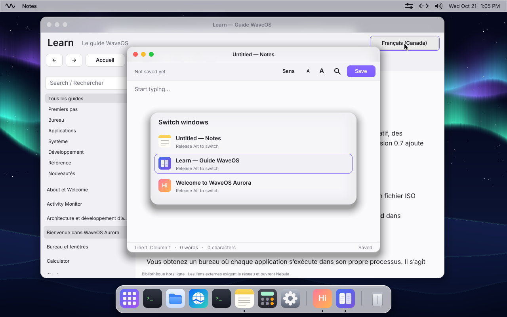

# Bureau et fenêtres
Organisez votre espace avec Harbor (le Dock), Apps et les commandes des fenêtres. Bienvenue propose une visite interactive facultative avec une fenêtre de pratique. Relancez-la depuis l’aide ou le menu WayV.

## Ouvrir et organiser les applications
1. Cliquez sur Apps dans Harbor, saisissez le nom d’une application et appuyez sur Entrée.
2. Survolez la bande discrète en haut de la fenêtre pour révéler ses commandes. Faites glisser cette bande pour déplacer la fenêtre, ou un bord ou n’importe lequel des quatre coins pour la redimensionner. Le pointeur indique la direction.
3. Faites glisser une fenêtre redimensionnable vers le bord gauche ou droit pour prévisualiser un partage de l’écran. Relâchez pour l’ancrer. Faites-la glisser vers le haut pour l’agrandir.
4. Éloignez la bande supérieure d’une fenêtre ancrée pour retrouver ses dimensions libres.

Les commandes apparaissent dans la fenêtre : réduire (un trait), agrandir ou restaurer (un carré), et fermer (×). Elles ne recouvrent ni ne déplacent le contenu. Alt+Espace leur donne le focus; Tab ou les flèches permettent de choisir, Entrée active la commande et Échap revient à l’application. Une application peut demander quoi faire du travail non enregistré avant de se fermer.

## Changer de fenêtre
Maintenez Alt et appuyez sur Tab pour ouvrir le sélecteur. Appuyez de nouveau sur Tab pour avancer, ou sur Maj+Tab pour reculer. Relâchez Alt ou appuyez sur Entrée pour choisir. Échap annule. Les fenêtres réduites sont affichées et sont restaurées lorsque vous les sélectionnez.

| Raccourci | Action |
|---|---|
| Super+Gauche / Droite | Ancrer à gauche / à droite |
| Super+Haut | Agrandir |
| Super+Bas | Restaurer; réduire si la fenêtre est déjà libre |
| Ctrl+W / Alt+F4 | Demander la fermeture de l’application active |
| Super+Espace / Ctrl+Espace | Recherche (Seek) |
| Alt+Espace | Activer les commandes de fenêtre |
| Super+Maj+3 / Impr. écran | Enregistrer une capture dans Pictures |

## Dépannage
Les applications à dimensions fixes ne peuvent pas être ancrées. Un partage inférieur aux dimensions minimales n’est pas disponible. Sous macOS, accordez à QEMU l’autorisation Accessibilité pour capter Commande; Control+Option+G libère la capture. Les touches injectées par QMP ne vérifient pas l’interception du clavier de l’hôte.

## Sélecteur de fenêtres

