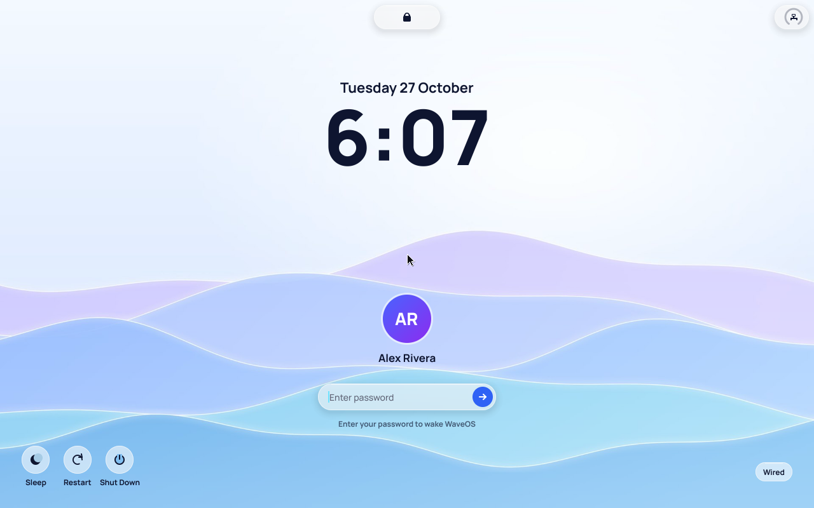
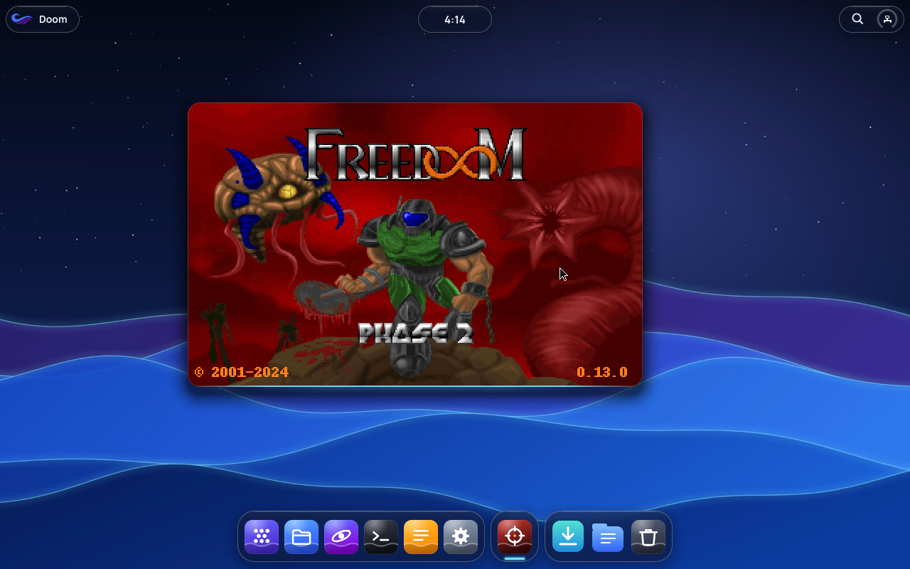
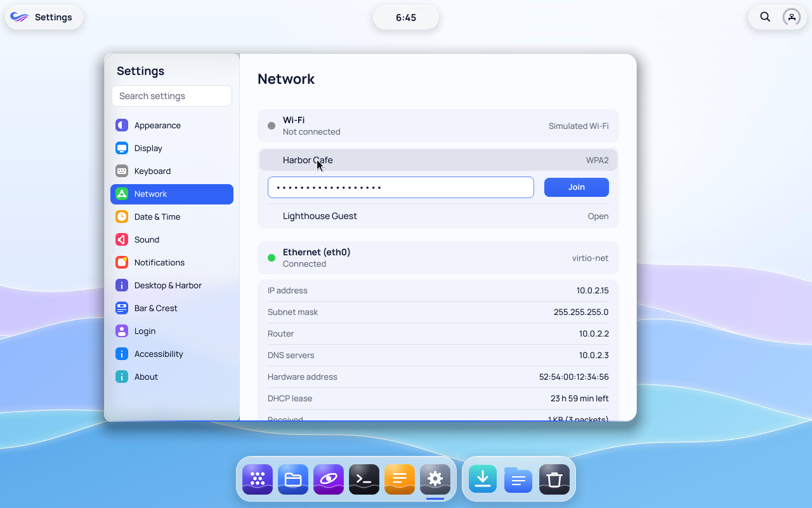

# WaveOS Aurora 0.9.0

Not yet published.

WaveOS draws faster, shows your battery, runs its first graphics driver from Linux, has Wi-Fi in Settings, works with every kind of USB controller, understands touchpads and game controllers, and every app is rebuilt on WaveUI, the new interface framework of the WaveSDK. This update includes every change listed for 0.8.0.

## Every app, rebuilt
- All fifteen apps that come with WaveOS are rewritten on **WaveUI**, a new declarative interface framework. They share one look and one set of controls: the same buttons, switches, lists, sidebars, toolbars, menus, alerts and sheets everywhere, in light and dark appearance and in your accent colour.
- Every control works from the keyboard: Tab moves between them, Space and Return press them, and the focused control scrolls into view.
- Scrolling is smooth everywhere, menus and sheets animate in (or don't, with Reduce Motion), and toolbar buttons explain themselves when you hover over them.
- Learn's handbook has a new look: each guide sits on a rounded page with a clearer title, rounded code samples and highlighted notes, in light and dark.

## Bigger, sharper screens
- With a virtio display, WaveOS offers every mode the screen reports, up to 5120 × 2160, and **Settings → Display** switches between them at once. When you resize the virtual machine's window, the desktop follows it.
- On screens of 2560 × 1440 and up, everything is drawn at twice the detail (HiDPI): text and controls stay the same size and become sharper. **Settings → Display → Scale** chooses Automatic, 1× or 2×, and changes take effect immediately.
- `cargo xtask run --resolution 2560x1440` starts the virtual machine at a chosen size.

## The apps, in the new design
- Every app now follows the Living Water design: one type scale, pill-shaped buttons, rounded cards, tinted selection, and Manrope Light for big numbers.
- **Notes** is a library: your notes, newest first, in a sidebar you can search. Notes save as you type, take their file name from their title, and checklists tick when you click them. They are plain text files in Documents → Notes.
- **Terminal** has tabs (Ctrl+T), and a coloured prompt that follows light and dark.
- **Calculator** shows thousands separators, rings the operation waiting for its second number, and keeps a tape of results (Ctrl+T).
- **Clock** has a timer ring that glows while it runs, and the world's times beside every tab.
- **Pulse** opens on an overview: four live gauges (processor, memory, disk, network) above the processes, which you can search.
- **Paint** has its tools down the side and a colour panel with a picker that is always open. **Lens** shows pictures edge to edge, with a floating toolbar and a strip of the other pictures in the folder.
- **Learn** opens on six short lessons that remember how far you read. **Studio** has a file tree, tabs for open files, line numbers, and build problems listed apart from the output.
- **Welcome** lets you pick a wallpaper and light or dark, and can show itself again at your next sign-in. **About** and **Installer** follow the new layouts.

## Faster
- The desktop's drawing takes less than half the time it did: window shadows, translucent fills, borders and glass are all quicker, and the login screen's background blur is about six times faster (measured on the host CPU; the data is in `docs/measurements/drawing-2026-10-27` in the source code).
- The window server draws with SSE2 in its own task, sends only the parts of the screen that changed when you drag a window, and maps the screen write-combining, so frames reach the display in bursts.
- The blinking caret on the login screen no longer repaints the whole screen.
- Pictures (JPEG) decode faster, with identical results.
- Firefox is ready about a third sooner: 25 to 31 seconds from the dock to its new tab page in QEMU emulating the processor, down from 40 to 47. The kernel serves programs with many threads better: small allocations no longer search the whole heap, `fork` shares memory copy-on-write instead of copying it (a second per Firefox process before), waiting threads wake only for what they wait on, and a system call no longer takes locks every thread of the process shares. Font lookups are cached, and Firefox skips work at start that WaveOS has no use for.
- `cargo xtask run` uses the processor's own virtualization when the host has it (KVM on Linux, HVF on Intel Macs, WHPX on Windows), which runs WaveOS many times faster than emulation; `AURORA_ACCEL` overrides the choice.

## Batteries
- Laptops' batteries and power adapters read correctly on more machines: two bugs in the ACPI interpreter that made some batteries read 0 %, or stopped the battery code altogether, are fixed.
- In a virtual machine, `cargo xtask run --battery=host` shows this computer's own battery in WaveOS, live, on Linux, macOS and Windows hosts.

## Graphics: drivers from Linux
- WaveOS can now run graphics drivers written for Linux. The first is Linux's own **virtio-gpu** driver with the DRM display core, unmodified, on a compatibility layer written for WaveOS. In a virtual machine with a virtio display (`cargo xtask run --gpu virtio`), it sets the display mode and shows the whole desktop.
- Only Linux code whose license allows it is included (MIT and similar). Where Linux's implementation is GPL-only, WaveOS has its own.

## Linux programs, and Doom
- WaveOS runs programs built for Linux. Static Linux x86-64 programs start as they are: they get Linux's system calls, a Linux-shaped set of folders (`/usr`, `/etc`, `/home`, `/tmp`…) beside your own, `/proc` and `/dev`, threads, and the clocks. Calls WaveOS doesn't have yet are listed in the system log.
- **BusyBox** comes with WaveOS, and its shell runs interactively: `sh -i` in Terminal gives you `ash`, with pipelines, loops, scripts and `trap`, and Ctrl+C interrupts what it runs. Its other commands (`awk`, `sed`, `sha256sum`, `tar`…) are where Linux programs expect them, in `/bin` and `/usr/bin`.
- Linux programs can start other programs: `fork`, `exec` (scripts too), `wait`, `posix_spawn`, signals and their handlers, `poll`, `select`, `epoll`, `eventfd` and `timerfd`.
- **Doom** is in Shoal, under the new **Play** group. It runs doomgeneric, the Doom engine, as a Linux program in a WaveOS window you can resize, with sound effects. Put your own `DOOM.WAD` or `DOOM2.WAD` in **Documents → Doom**, or let the app download **Freedoom**, free game data for both phases (24 MB).
- Dynamically linked programs run too: Debian's own `bash`, coreutils and Python 3 start as they do on Debian, with their libraries. `cargo xtask run` fetches Debian packages (checked against the archive's checksums) and puts them on the disk, Firefox ESR 140 among them (`--no-linux-root` leaves them off). Libraries that several programs, or processes, map are read from the disk once and shared.
- Linux programs reach the network: TCP and UDP sockets over WaveOS's network stack, name lookups, and local sockets that pass descriptors along. Debian's Python fetches web pages.
- Linux programs can open WaveOS windows, read the keyboard and mouse, and play sound, through the calls in `waveos.h`.
- **Wayland programs** show their windows on WaveOS: `wl-bridge`, a small Wayland compositor that comes with WaveOS, turns each window of a GTK (or Qt, SDL…) program into a WaveOS window, with its menus, the mouse, the keyboard and the clipboard. Debian's `gtk3-demo` runs in it. Linux programs also share memory now (`memfd`, `/dev/shm`, `MAP_SHARED`).
- **Voyage** is the web browser: our own, around WebKit, the engine of Safari (Debian's WebKitGTK 2.50), with full JavaScript (JavaScriptCore and its JIT), CSS, web fonts and media. It's in the dock, and web links in Learn and About and `.html` files open in it. Its toolbar is the window's title bar (back, forward, reload, an address field that also searches, a new tab), with tabs, find in page, zoom, downloads to Downloads, cookies and site data kept between visits, and WaveOS's light or dark look; it shows a page in about half the time Firefox takes. Video and sound play, streaming sites included: the Linux packages bring GStreamer's codecs for VP9, AV1, H.264, Opus and AAC, and Linux programs get sound through OSS (`/dev/dsp`, a WaveOS sound stream). To run WebKit, the Linux layer now hands out memory as it is touched (WebKit reserves 8 GiB at a time), turns on AVX for programs (XSAVE), and passes a sender's credentials over local sockets.
- **Firefox**, with full JavaScript too: Debian's Firefox ESR 140, unchanged, in a WaveOS window, from Shoal and Seek. It starts clean and fits the desktop: no welcome tour or warning bars, no window buttons of its own (WaveOS's handle has them), a compact toolbar, a new tab page with just a search box, nothing sent to Mozilla, the dark theme when WaveOS is dark, downloads in Downloads. It shows Chinese, Japanese and Korean text too. Its sandboxes are off for now, as WaveOS doesn't yet have the Linux features they need, and its pages share a few processes rather than one per site, which makes it start much faster on WaveOS.
- **For JavaScript engines and games:** faults in Linux programs (a bad memory access, an invalid instruction, a division by zero) now reach the program's own signal handler, signals reach a thread even while it runs its own code, clocks are read without a system call (a vDSO), and threads wait and wake on futexes more efficiently. Linux programs can watch their windows' events with `poll` and `epoll`, learn when each frame they drew is on screen, and choose the pointer's shape.
- **NetSurf** takes Nebula's place as the small browser. NetSurf 3.11 starts in seconds: HTML and CSS pages with pictures, over HTTP and HTTPS, with cookies, sharp on 2× screens, without JavaScript. It is a Linux program in `/System/NetSurf` that draws straight into its WaveOS window, so it needs no Linux packages on the disk: it opens from Shoal or Seek, and in Voyage's place when the packages aren't there. Nebula's engine stays, laying out Learn's handbook, and `js` in Terminal still runs Pulsar.
- The installation disc (`cargo xtask iso`) carries the system compressed again, so it builds and boots now that the system is larger.

## Wi-Fi
- **Settings → Network** has a Wi-Fi section: the networks around you, a password field, **Join** and **Disconnect**. WaveOS joins open and WPA2-Personal networks; WEP, WPA3-only and enterprise networks are listed but can't be joined yet.
- When you're on Wi-Fi, the status ring shows the Wi-Fi symbol and Current shows the network's name.
- Intel Wi-Fi adapters (Wireless 7265 to Wi-Fi 6E AX211) are recognized, but WaveOS can't start their radio yet; Settings says so. Wi-Fi works today on the simulated networks for testing (`cargo xtask run --wifi-sim`, network "Harbor Cafe", password "tide pools at dawn").

## USB on older computers too
- WaveOS now drives every kind of USB controller: besides USB 3 (xHCI), the USB 2 controllers (EHCI) of computers from before about 2012, and the USB 1.1 controllers (OHCI and UHCI) that come with them. Keyboards, mice, hubs and USB sticks work on all of them, plugged in at any time.
- That includes VirtualBox's USB 2.0 controller (EHCI with OHCI).
- USB sticks are ready sooner: mounting one now takes about a second, on any controller.

## Keyboards, mice, touchpads and game controllers
- **Keyboards:** every key counts, however many you hold down; volume, play/pause, brightness and browser keys work; and the Caps Lock light follows the key on every keyboard you have connected.
- **Mice:** the side buttons go back and forward, and mice with a tilting or second wheel scroll sideways.
- **Touchpads** (USB): tap to click, tap with two fingers for a secondary click, tap then touch again to drag, press with two fingers for a secondary click, and scroll with two fingers — smoothly, with the content gliding on after a quick flick. Scrolling follows your fingers, as on a touch screen.
- **Game controllers:** Xbox 360, Xbox One and Series, PlayStation (DualShock 4 and DualSense), Switch Pro and other USB controllers work, all with the same button layout for games, and rumble on the controllers that have it.
- PS/2 mice with side buttons work too.
- **Settings** has new **Trackpad**, **Mouse** and **Game Controllers** panes: tap to click, natural scrolling, tracking and pointer speed, and each connected controller with a live view of its buttons and a vibration test.

## For developers
- **The WaveSDK** is the new name of the Constellation SDK. The `wavesdk` command replaces `constellation`, which still works; packages made for SDK 0.6 to 0.8 still install, and new ones say SDK 0.9.
- **WaveUI**, in the WaveSDK, is how WaveOS apps are now written: describe the interface from your app's state, and WaveUI does layout, drawing, input, focus, scrolling, menus, sheets and animation. New projects in Studio and `wavesdk new` start as WaveUI apps, and the WaveUI Gallery example shows every view.
- Learn has three new guides for developers: [WaveUI](../../handbook/0.7/en/developer-waveui.md), [WaveSDK](../../handbook/0.7/en/developer-wavesdk.md) and the [Design guidelines](../../handbook/0.7/en/developer-design.md).
- `cargo xtask run --gpu virtio` boots with a virtio display driven by the Linux driver; `cargo xtask test --gpu virtio` also checks that the display came up.
- `cargo xtask run --wifi-sim` adds the simulated Wi-Fi networks.
- `cargo xtask run --usb ehci` (also `ehci-ohci`, `ohci`, `uhci`) picks the USB controller the virtual machine has.
- Apps can read game controllers with `corekit::gamepad`: the connected controllers, their buttons, sticks and triggers in the standard layout, and rumble. Scroll events now also carry the exact amount, for smooth scrolling.
- Building the graphics drivers needs clang. Without it, the kernel builds without them.
- Building the Linux programs (the self-test and Doom) needs `musl-gcc` (`sudo apt install musl-tools`). Without it, the image is built without them. `docs/LINUX.md` in the source code explains what Linux programs see, and `libs/linux/include/waveos.h` lets C programs built for Linux open WaveOS windows.

## Known limitations
Laptops' built-in touchpads mostly connect over I²C, which WaveOS doesn't drive yet; many also work as a plain PS/2 pointer, without gestures. Bluetooth keyboards, mice and controllers aren't supported. The new USB controllers (EHCI, OHCI, UHCI) have been tested in virtual machines only. No real Wi-Fi adapter works yet: the Intel driver stops before starting the radio, and none of it has run on real hardware. The Linux graphics driver works in virtual machines (virtio); drivers for AMD, Intel and NVIDIA graphics, and 3D acceleration, are not there yet. NetSurf doesn't run JavaScript, so pages that rely on scripts can be incomplete, and many SVG pictures don't show; click its address bar to either side of the window handle at the top centre. Voyage takes about fifteen seconds to show a page, and Firefox about half a minute, in a virtual machine that emulates the processor (as on Macs with Apple silicon); both draw without the graphics card and run without their sandboxes, which need Linux features WaveOS doesn't have yet. Disks made before this update get the Linux packages they lack when WaveOS next starts with `cargo xtask run`; a disk without room for them is made bigger first, keeping every file on it. Voyage and Firefox need 2 GiB of memory (the desktop with a Wikipedia article open in Voyage uses about 850 MiB, and with 1 GiB WebKit can't load), and the USB image with their packages is about 1.8 GiB (a 4 GB stick); [Hardware and power](../../handbook/0.7/en/system-hardware.md) now lists what a PC needs. There is no terminal device yet, so the shell has no job control and full-screen programs like `vi` don't work; Doom plays no music. In this update's test machine the firmware did not wake from sleep, so the sleep test was skipped; it was skipped the same way on 0.8.0's code.

## Evidence
`cargo xtask lint`, the host tests in [Building and testing](../../handbook/0.7/en/developer-build.md) (now including the Wi-Fi library's tests against the IEEE 802.11 test vectors and an independent implementation), and the kernel self-tests on both boots (41 tests, including the self-tests of the Linux driver layer and of Linux programs (files, memory, threads, processes, signals and sockets), and a WPA2 connection with DHCP on the simulated network) were run on the change, as was `cargo xtask test --gpu virtio`. Doom was played in QEMU (menu, a new game, moving and firing, with its sound captured to a file and checked), the Freedoom download was unpacked inside WaveOS, and the ISO was booted. With the Linux packages on the disk, Debian's `weston-simple-shm` and `gtk3-demo` ran through `wl-bridge` (windows, menus, clicks and keys), and Firefox ESR was opened from Seek and loaded pages over HTTP and HTTPS (the test machine's network re-signs HTTPS, so its certificate authority was given to Firefox for that test). With Firefox built in, it was opened from the dock eight times in a row on a 1920 × 1080 virtio-gpu screen with no process crashing, showed its new tab page and loaded example.com, Chinese text included; a disk made before the change got the packages it lacked when it was next started. Its start was timed from the click on the dock to its new tab page (the Firefox logo on screen): 40.4 and 46.6 seconds before the kernel changes above, 24.8 to 31.2 seconds after, over more than twenty starts; a test checks that memory shared by `fork` stays private to whichever side writes it, by a program or by the kernel for a system call. NetSurf was opened from the dock at 1× and at 2× (2560 × 1440): it loaded pages over HTTP and HTTPS (with the same certificate authority added through `WAVEOS_EXTRA_CA`), followed links, went back and forward, scrolled, zoomed, resized and took typing in its address bar. The USB and input tests ran on each USB controller (`--usb xhci`, `ehci`, `ehci-ohci`, `ohci`, `uhci`), with virtual devices plugged in over USB redirection: a keyboard with media keys, a Precision Touchpad, a DualShock 4 and an Xbox 360 controller; the input library has its own tests against those devices' descriptors. The screenshots in `docs/screenshots/0.9` come from QEMU at 1280 × 800. A disk made the way the previous build made it, with Firefox and too little room for WebKit, was made 902 MiB bigger by `cargo xtask run`, kept its files (compared one by one) and opened Voyage from the dock.
