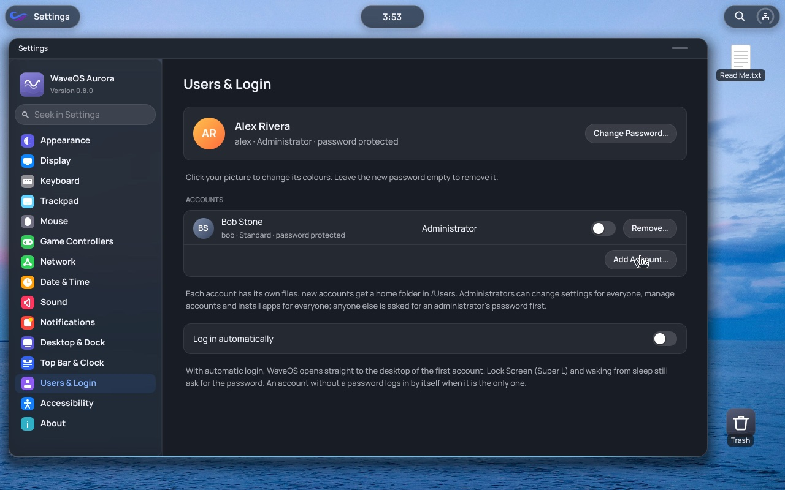
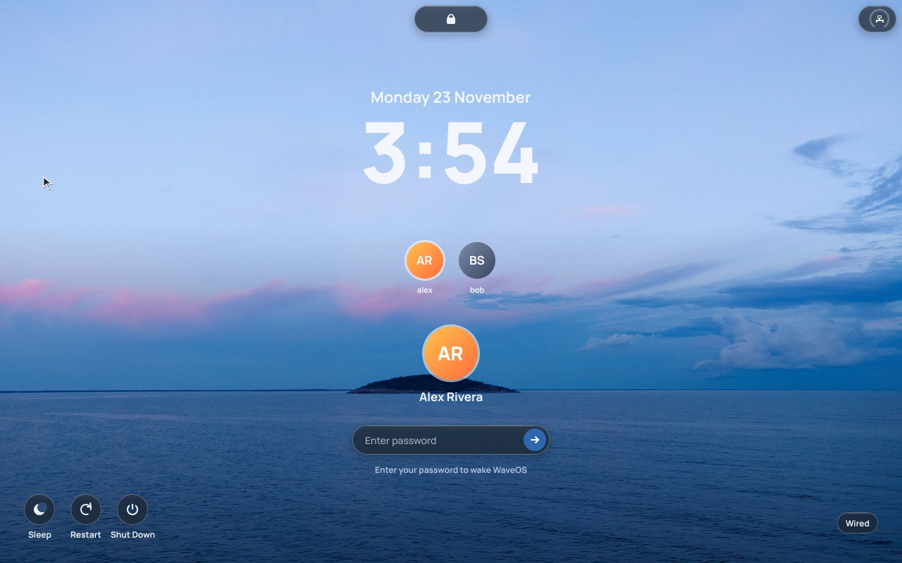
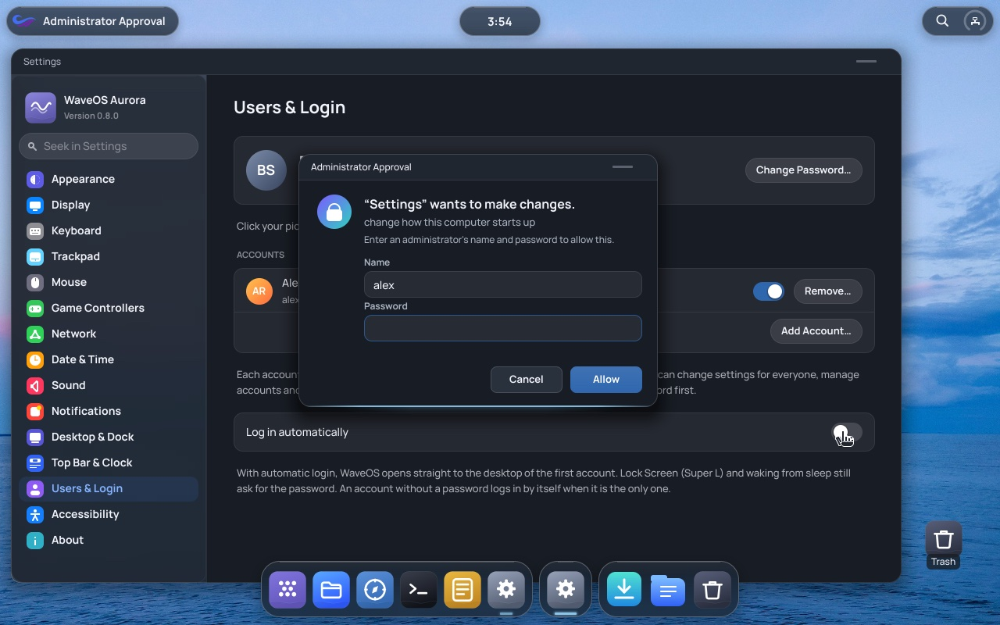
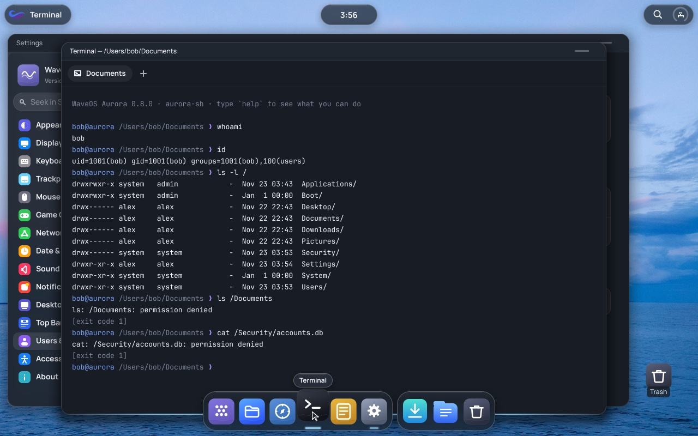

# Accounts, permissions and the login screen: validation

Headless QEMU, 1280×800, a fresh disk, the "Calmer WAVEOS" shell (`ec42ce1`).
All pictures are framebuffer captures (`tools/qmp.py`).

1. First-run setup created *Alex Rivera* (`alex`, uid 1000, administrator)
   with a password; the desktop and Welcome followed as before.
2. Restarting on that disk showed the login screen (one account with a
   password, automatic login off). Four wrong passwords: the fourth is
   refused with "Too many tries · try again in N s".
3. Settings → Users & Login, as Alex: *Add Account…* made *Bob Stone* (`bob`,
   uid 1001, standard) and `/Users/bob` with private Desktop, Documents,
   Downloads and Pictures.

   
4. WayV menu → *Switch User…*: Alex's processes ended, Shore offered both
   accounts; Bob logged in. Alex's desktop items are not shown to Bob.

   
5. As Bob, turning on *Log in automatically* (a setting for every account)
   brought up the administrator prompt; Alex's name and password allowed it
   and Settings got the capability for five minutes.

   
6. Terminal as Bob: `whoami`, `id`, `ls -l /` (owners, groups and modes),
   `ls /Documents` and `cat /Security/accounts.db` refused; `passwd` hides
   what is typed and changed the password; Super L locked the screen and
   the new password unlocked it.

   

`cargo xtask test` (both boots) runs `usertest`'s identity checks: new files
belong to their creator with `rw-r--r--`, `chmod`, the system image belongs
to the system, `cred_set` can't become someone else, and — in a child that
dropped the administrator capability — writing to `/Applications`, listing
`/Security`, renaming it, adding an account, changing automatic login,
taking the capability back and giving a file away are all refused, while the
owner can lock themself out of a file and back in. `cargo test -p aurorafs`
covers owners on disk: persistence, journaling across power cuts, volumes
from before owners, an older kernel's rewrites, and fsck.
