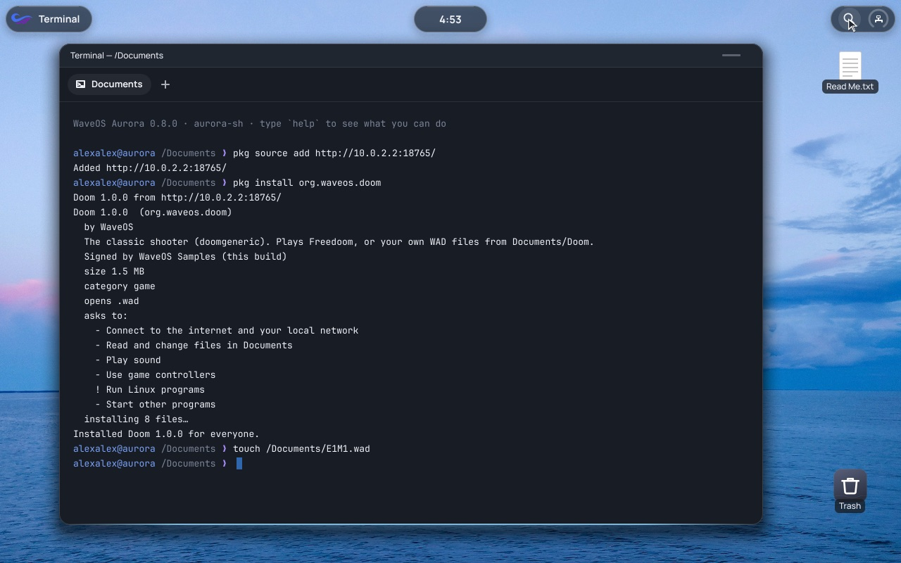
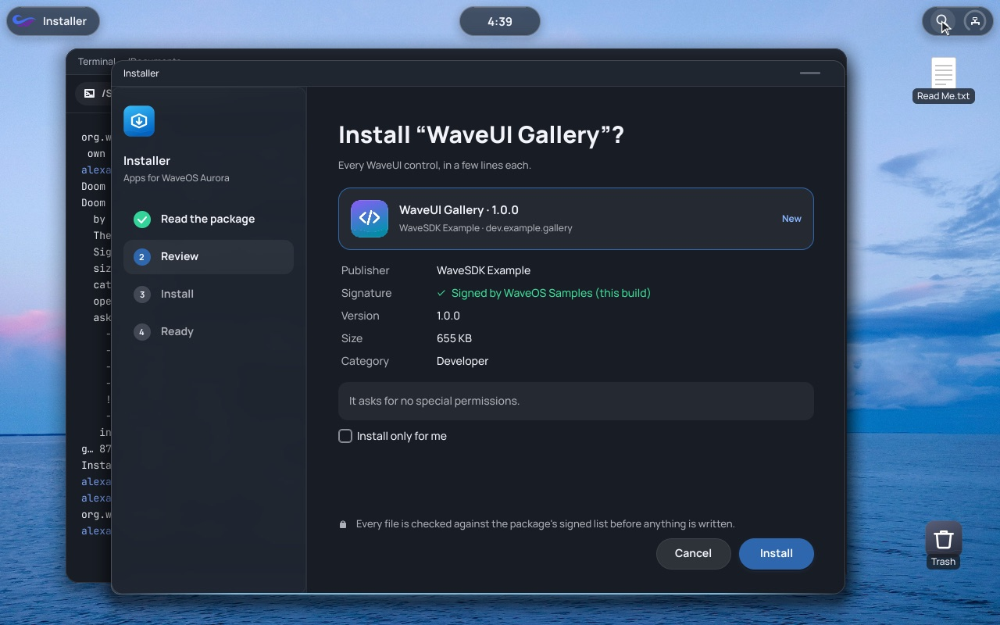
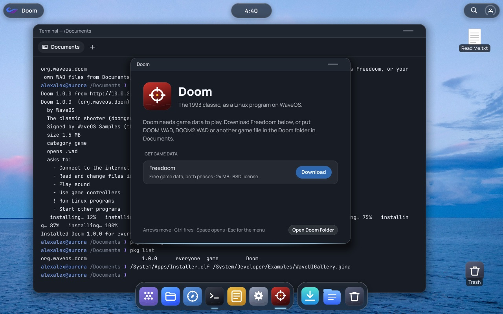
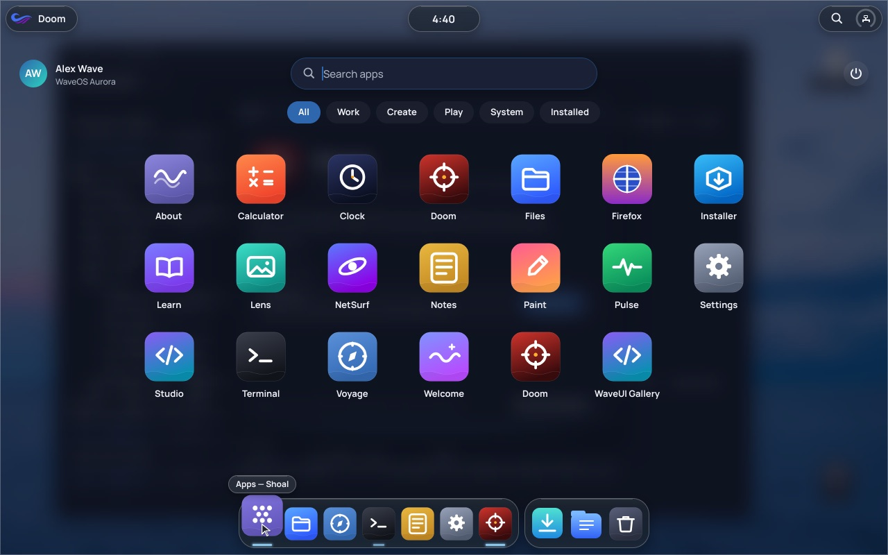
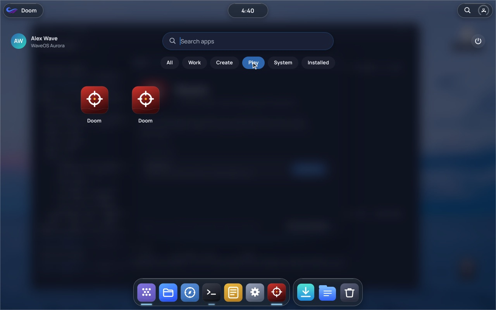
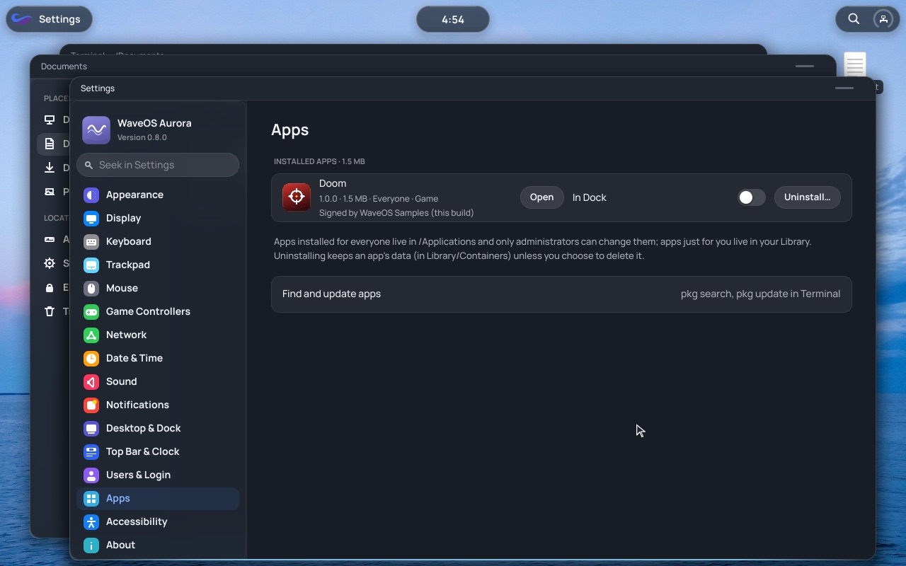
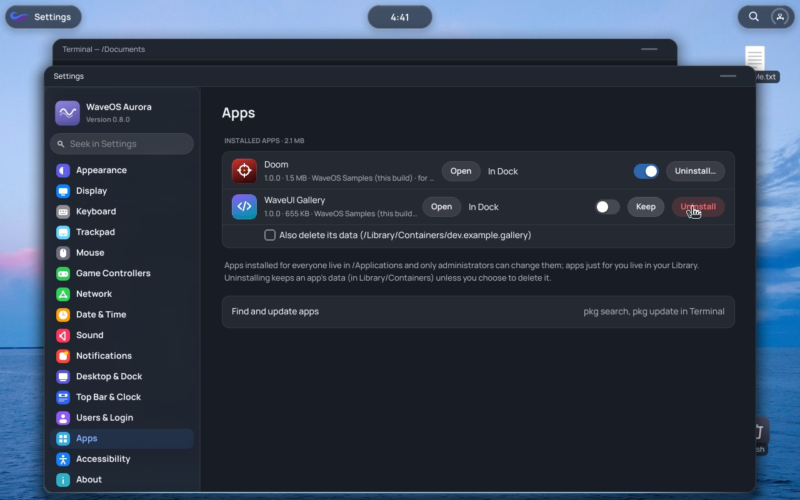
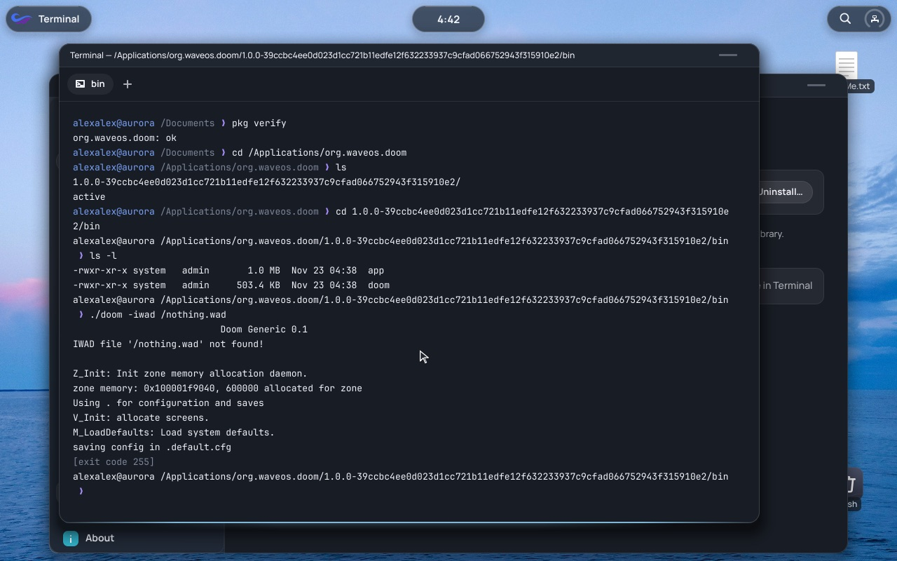
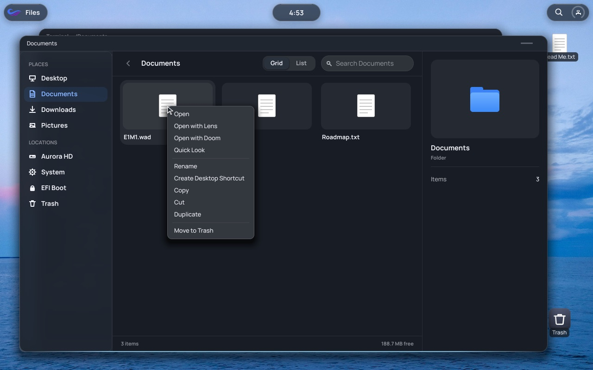
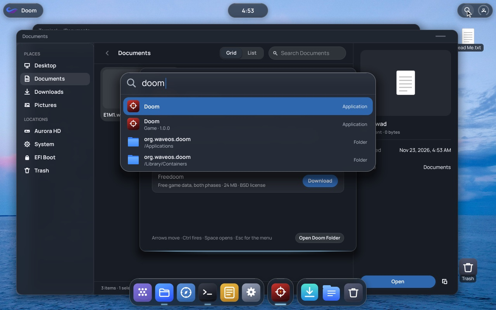

# Installable apps: validation

Headless QEMU, 1280×800, a fresh disk, after first-run setup of an
administrator account (*Alex Wave*). The build's sample repository
(`target/repo`, written by `cargo xtask build`) was served from the host with
`python3 -m http.server -d target/repo 18765`. All pictures are framebuffer
captures (`tools/qmp.py`).

1. Terminal: `pkg source add http://10.0.2.2:18765/`, `pkg search` (both
   samples), `pkg install org.waveos.doom` (shows publisher, *Signed by
   WaveOS Samples (this build)*, size, category, `.wad`, the permissions with
   `linux` flagged), `pkg pin org.waveos.doom`, `pkg list`.

   
2. `Installer.elf /System/Developer/Examples/WaveUIGallery.gina` (what
   double-clicking a `.gina` in Files runs): review page.

   
3. *Install only for me*, Install, Done: the Gallery went to
   `~/Library/Applications` (no administrator prompt).
4. The dock shows Doom (pinned) with its own icon, and its waterline while
   the packaged launcher runs from `/Applications`.

   
5. Shoal lists both installed apps with their icons (the built-in Doom is
   still there too); under *Play*, the installed game.

   
   
6. Settings → Apps: size, scope, publisher, *In Dock*, *Uninstall…* with
   "Also delete its data". Uninstalling the Gallery removed it at once.

   
   
7. `pkg verify` → `org.waveos.doom: ok`; the installed files are
   `system admin rwxr-xr-x`; the packaged Linux game binary runs from
   `/Applications/org.waveos.doom/<generation>/bin` (it reports the missing
   WAD, as expected without game data).

   
8. Files, right-click on a `.wad` file: *Open with Doom* (the package's
   `extensions = ["wad"]`) started `/Applications/org.waveos.doom/…/bin/app`.
   Seek finds the installed Doom as *Game · 1.0.0*; the *In Dock* switch in
   Settings → Apps pinned it at once.

   
   

Not exercised in the UI: a standard (non-administrator) account installing
for everyone, which goes through the administrator prompt
(`corekit::apps::authorize` → `users::elevate`); the kernel refuses writes
to `/Applications` without the capability either way.

## Automated

- `cargo xtask test`: *packages: install, update and remove from a
  repository (pkgtest)* (56 passed on both boots, on top of `9e60f87`). `pkgtest` adds the
  host's test repository, checks that an index altered after signing is
  refused, installs Gallery 1.0.0 for everyone, verifies hashes, owner and
  mode, refuses an unsigned package without consent and one with a bad
  signature, ignores a stale staging folder, updates to 1.1.0 keeping the
  app's data and removing the old generation, refuses a downgrade, installs
  Doom as a game with its icon, pins it, and checks the registry and its
  owner; the kernel then checks the desktop's view (version, icon, game,
  pinned), `pkgtest remove` uninstalls both (with and without data), and the
  kernel checks they are gone from the desktop and the dock.
- `cargo test -p gina -p xtask`: format 2, signatures, hostile paths,
  links, case-folded duplicates, depth and size limits, altered payloads,
  manifests and indexes, version order, dependencies, and mutation fuzzing
  of packages, manifests, indexes and records; the repository writer.
