# Calmer WAVEOS: design and validation

Implemented on `codex/calm-native-experience`, starting from `3f25b79`.
Validation date: 1 November 2026. This is a native Rust change to Lumen,
AuroraKit, WaveUI, the shell, and the built-in apps.

## Delivered

- Shared neutral light/dark surfaces, restrained navigation glass, Manrope
  typography, smaller radii, consistent focus and selection treatments, and
  wallpaper-adaptive accents. Settings descriptive rows wrap within their bounds.
- A permanent 34-point compositor strip contains each window title, move area,
  and smoothly revealed minimize, maximize/restore, and close controls. Client
  geometry, input, materials, minimum sizes, and animation snapshots exclude it.
  Alt+Space reveals keyboard controls; Tab/arrows select, Enter activates.
- One hit-test defines cursor feedback and resizing on every edge and corner.
  Corners precede chrome. Resizing preserves the opposite edge, minimum size,
  stacking, and work-area bounds. Clicking an arranged title does not restore
  the window; dragging restores it after a four-point movement threshold.
- Rounded raster-cached native cursor silhouettes, including both diagonal
  resize directions, grab/grabbing, copy feedback, progress, and wait. Existing
  cursor values 0–9 remain unchanged; 10–15 are additive. Actual app operation
  and hit state select the cursor. Inactive activity cursors stop scheduling.
- Shared 120/180/240 ms feedback/reveal/transition timing, reversible hover
  fades, shell panel reveals, window transitions, and snapping. Cached panel
  snapshots expire. Reduce Motion stops motion in controls, shell surfaces,
  Harbor, notifications, water, and the tour; solid/high-contrast alternatives
  follow the existing accessibility preferences.
- Clearer Apps, Search, Quick Settings, Dock, and clock descriptions alongside
  the system's names. Native apps share the new foundations; Files, Notes, Learn,
  and Welcome have specific layout/discovery refinements. Native app minimum
  sizes are declared through an opt-in, backward-compatible window-create flag.
  External applications receive the same compositor frame.
- Nineteen simplified app icon sources and their bundled renders, with a
  quieter water detail and less gloss. Voyage has a dedicated compass icon.
- Six real photographs: Tide, Mist, Dunes, Ripple, Coast, and Alpine. Native
  resolution source JPEGs, 4096×2560 runtime derivatives, and 480×300 thumbnails
  are bundled. Both appearances use the same photograph. Existing built-in
  preference slots 0–2 retain their natural categories; custom slot 255 remains.
  [Photographer, license, modifications, and source credits](../../assets/WALLPAPER-CREDITS.md)
  include source hashes. `tools/prepare_wallpapers.py` reproduces the derivatives
  offline, with no upscaling or recoloring.
- Optional six-step shell-owned tour from Welcome and Help, with anchored
  arrows, finite demonstrations, live practice, Back/Next/Skip/Escape, keyboard
  focus, responsive placement, and persisted completion. Practice is temporary
  and does not open or change user documents. Request `desktop::START_TOUR` is
  narrowly scoped and validates its arguments.
- Updated [WaveSDK](../WAVESDK.md) and English/Canadian French handbook design
  and window guidance. Existing bilingual Help content remains packaged.

## Before and after

The baseline kernel/apps and disposable disk were captured before editing.
All screenshots are actual QEMU framebuffer captures, not browser mockups.
The old disk was also rebooted without refresh for the matching light captures.
Resolution is 1280×800 unless a filename specifies 2×. Window content is allowed
to shrink by the permanently reserved chrome strip; the app content no longer
shares that area with controls.

| State | Baseline | Updated |
| --- | --- | --- |
| Files, dark | 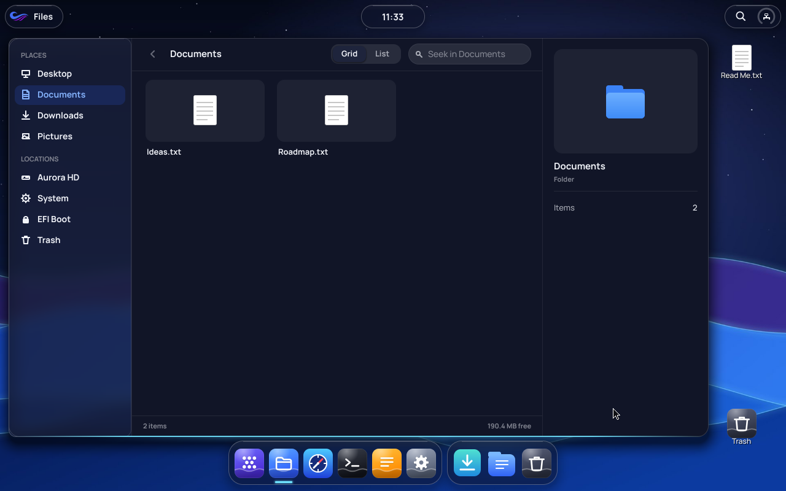 | 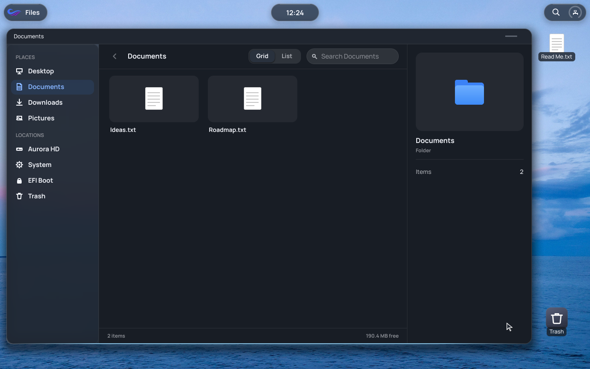 |
| Files, light | 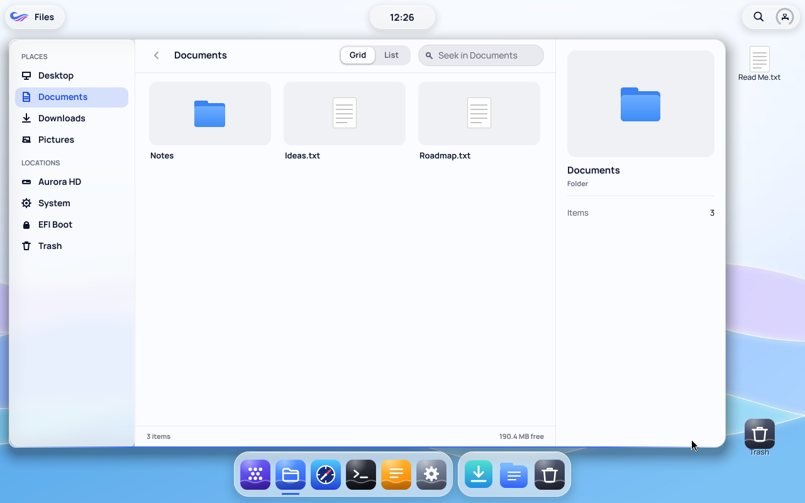 | 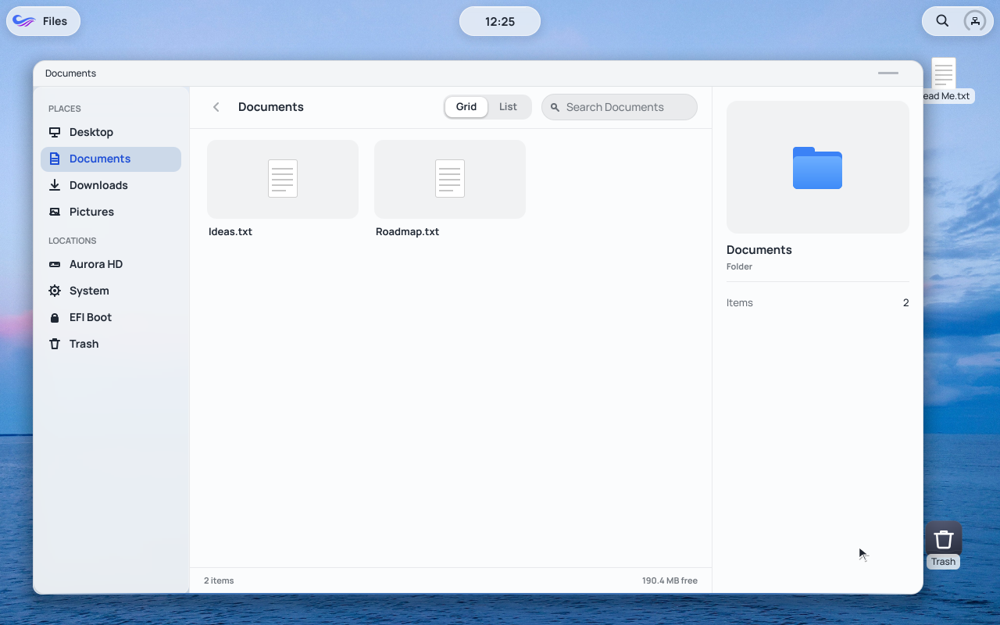 |
| Settings, dark | 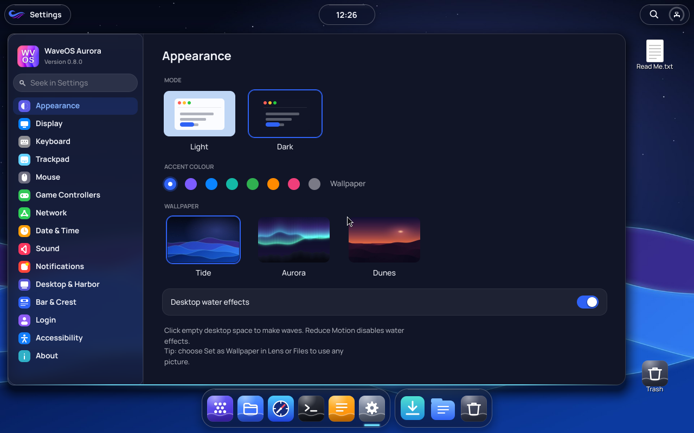 |  |
| Settings, light | 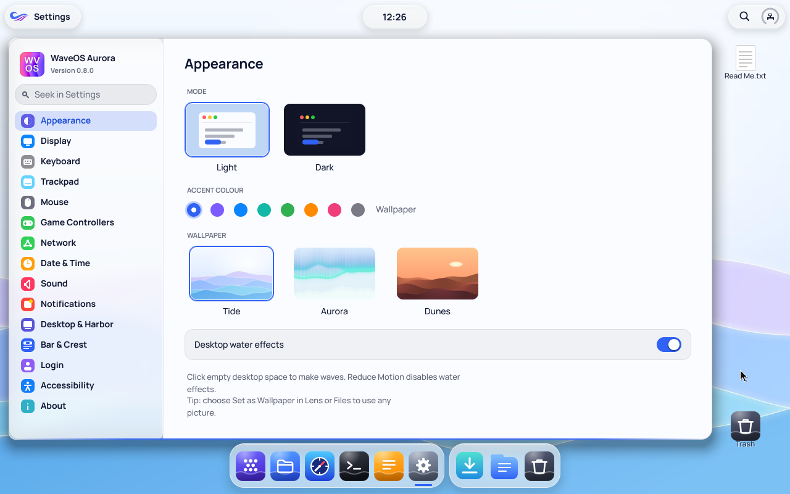 | 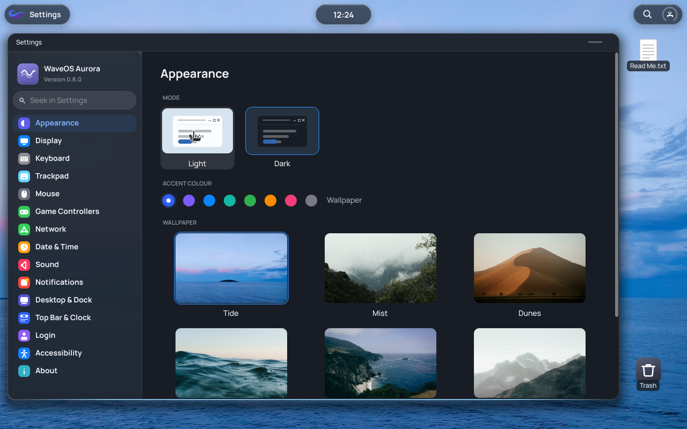 |

| Light | Dark |
| --- | --- |
| 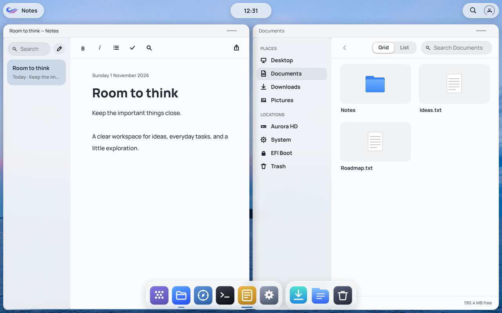 | 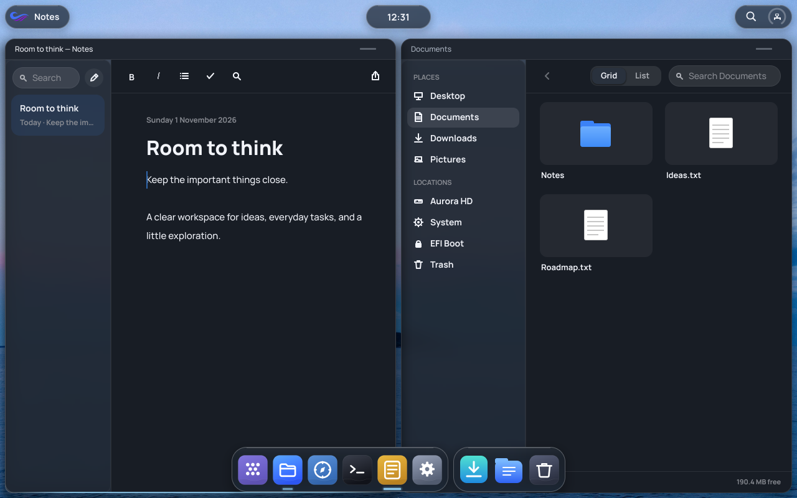 |
|  | 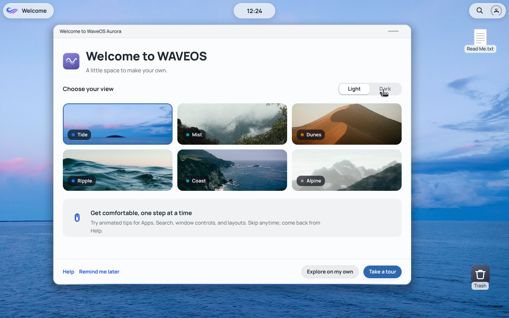 |
| 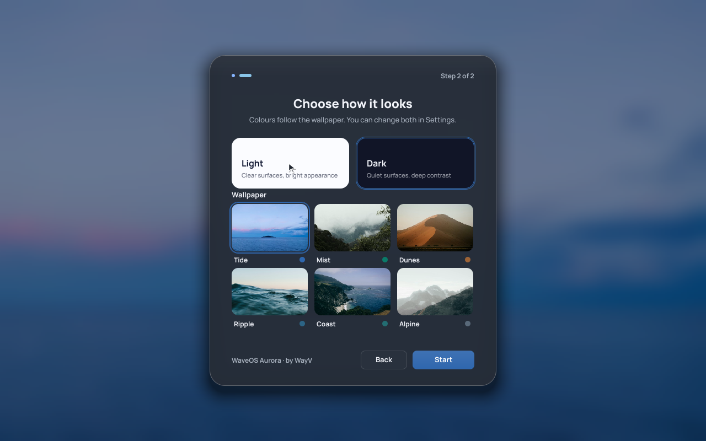 |  |

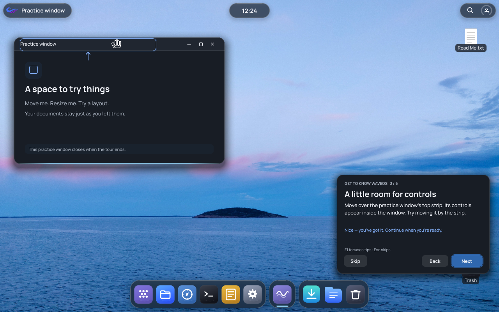

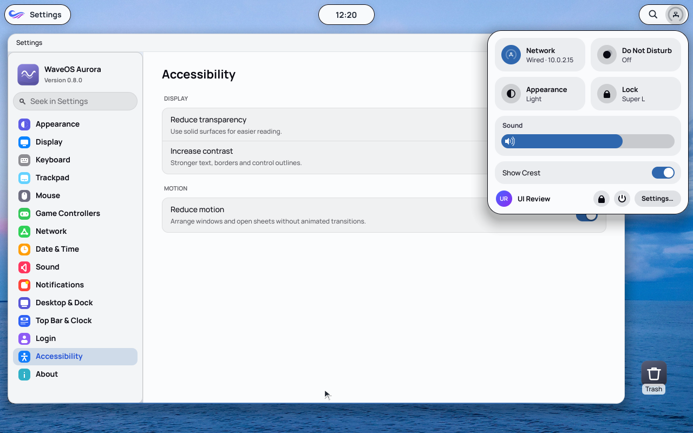

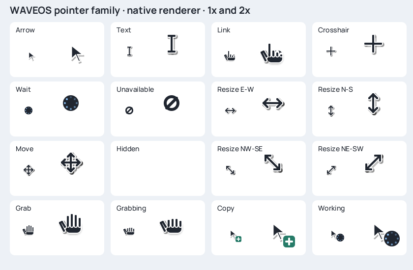

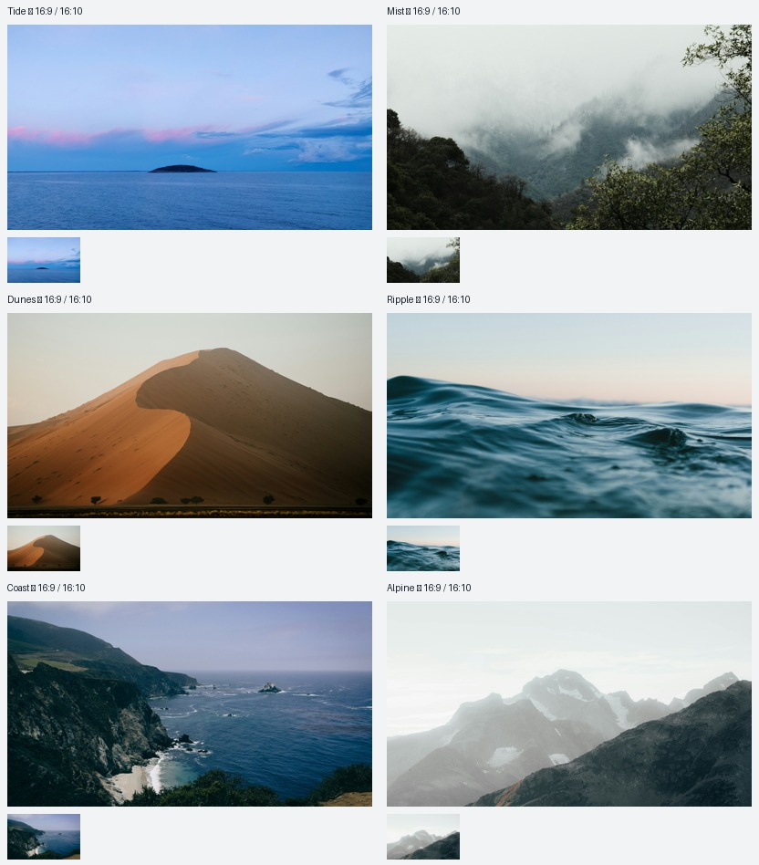

## Automated checks

| Command | Result |
| --- | --- |
| `cargo xtask build` | Production kernel, userland, and packaged apps built successfully. |
| `cargo xtask lint` | Passed. |
| `cargo xtask docs` | English and Canadian French Help generated successfully. |
| `cargo fmt --all --check` | Passed. |
| `cargo fmt --manifest-path userland/Cargo.toml --all --check` | Passed. |
| `git diff --check` | Passed. |
| `cargo test -p lumen -p aurora-abi -p aurora-image -p xtask` | 54 host tests passed, including shared hit-testing, resize anchoring/bounds, and interrupted fades. |
| `AURORA_TEST_NO_USBREDIR=1 cargo xtask test` | 40 kernel tests passed on each of two boots, including reboot persistence and S3 wake. |
| `target/ui-refresh/venv/bin/python tools/smoke_ui_refresh.py OUTPUT --log SERIAL_LOG` | Native QEMU geometry and interaction checks passed. |
| `/System/Apps/Files.elf --self-check` inside the guest | Search repetition, 64 MiB copy, cross-volume transfer, tab isolation, cancellation, cleanup: `FILES CHECK PASS`. |

Recorded [build](evidence/ui-refresh/build.txt), [lint](evidence/ui-refresh/lint.txt),
[host](evidence/ui-refresh/host-tests.txt), [kernel](evidence/ui-refresh/kernel-tests.txt),
and [interaction](evidence/ui-refresh/resize-check.txt) output is included.

The default kernel-test launch cannot start with this host's QEMU because that
binary has no `usb-redir` device. The supported `AURORA_TEST_NO_USBREDIR=1`
configuration explicitly skips the virtual USB HID/controller injection check.
Its other kernel tests still run. This is not a pass for the skipped check.

## QEMU interaction coverage

- Four resize edges and four corners; visual frame-boundary assertions verify
  that top corners are not stolen by chrome. Practice and native Files minimum
  sizes, screen bounds, directional cursors, hover, and keyboard controls.
  The [compact practice layout](../screenshots/ui-refresh/practice-minimum.png)
  was checked after the final minimum-height adjustment.
- Arranged/maximized title clicks and small pointer jitter; restoration only
  when dragging. Actual snapping and switching, overlapping native windows,
  control reveal and rapid pointer exit/reentry, and interrupted transitions.
- All six tour steps, opening Apps/Search/Quick Settings, moving/resizing and
  arranging practice, Skip/Escape/replay, and completion across reboot. The
  `tour_completed` preference remains set when a later replay is skipped.
- Fresh account setup, all six photographic thumbnails, Welcome, and matching
  native app screens in light/dark. Source/derivative dimensions, hashes, and
  16:9/16:10 photo crops checked. Native 1× at 1280×800 and 2× at 2560×1600,
  including hover controls, cursor rendering, editing, and Paint saving.
  At 1920×1080, moved practice anchors and the photo gallery were checked.
  [Tour at 16:9](../screenshots/ui-refresh/tour-1920x1080.png),
  [photo gallery](../screenshots/ui-refresh/settings-1920x1080.png), and
  [correct pixel confirmation at 2×](../screenshots/ui-refresh/display-confirm-2x.png).
- Settings' three accessibility options together; their solid/contrast UI and
  persisted values after reboot. They were restored afterward on the review disk.
- Notes text editing and saving; Paint drawing, unsaved-close prompt, Escape to
  cancel, save sheet, PNG save, then close. The saved PNG was listed in Pictures.
  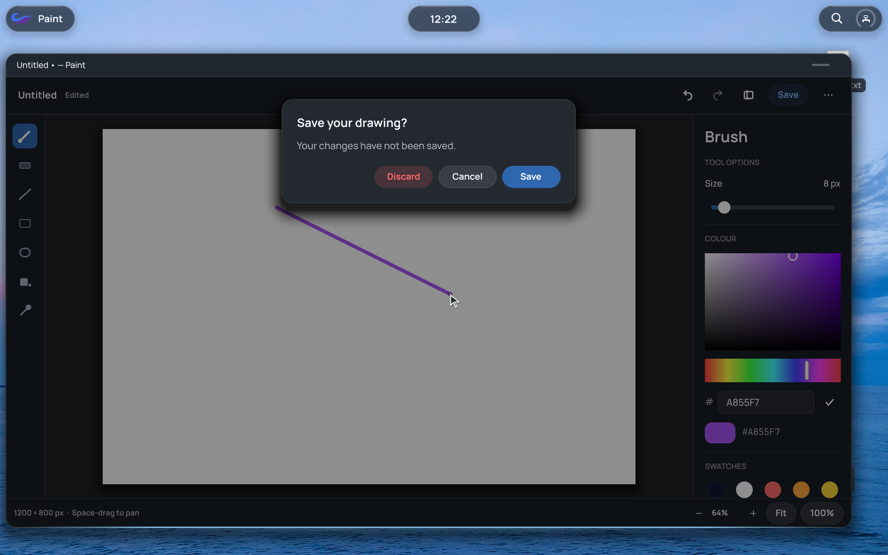
- Learn's existing offline articles render in the kernel suite; handbook design
  and desktop changes are supplied in both English and Canadian French.

## Desktop performance

`tools/benchmark_ui.py` drives identical real workloads at 1280×800, 4 vCPUs,
4 GiB, QEMU TCG: one warm-up and three measured repetitions. It uses native
Notes/Files, Super-drag, typing, and Alt+Tab. No compilation ran during the
accepted performance measurements. Values below are mean compositor paint time
across logged frames, including cursor and partial updates; they are not FPS or
end-to-end input latency, and frame counts change with the motion policy.

| Workload | Baseline mean | Updated mean | Full frames, before → after |
| --- | ---: | ---: | ---: |
| Pointer traversal | 2.33 ms | 0.37 ms | 3 → 0 |
| Window dragging | 37.67 ms | 27.92 ms | 85 → 60 |
| Typing | 0.67 ms | 1.63 ms | 0 → 0 |
| App switching | 39.24 ms | 31.11 ms | 31 → 18 |

Typing produces more small feedback frames (93 → 128). The bounded chrome
damage and cached cursor rasters avoid unnecessary whole-scene repaints. The
10-second idle interval recorded zero baseline frames and one updated frame;
serial timestamps identify the latter as the minute clock update. After settling,
there is no continuing decorative animation. Raw
[baseline](evidence/ui-refresh/baseline-performance.json) and
[updated](evidence/ui-refresh/candidate-performance.json) measurements are bundled.

## Validation limits and review build

Physical hardware, real display latency, external browser application internals,
and host keyboard capture were not qualified in this task. Injected QMP keys do
not prove macOS Command-key interception. Every built-in app receives the shared
styles/chrome, but exhaustive workflows in every app and every accessibility,
window-size, and language combination are not claimed. These limits are separate
from the concrete native QEMU checks above.

The user's original `target/waveos-aurora.img` was preserved. Disposable review,
baseline, and setup images and raw serial captures are in `target/ui-refresh/`.
To review the updated desktop using the disposable account:

```sh
cargo xtask run --no-build --no-linux-root --no-sound --no-keyboard-capture \
  --disk-image target/ui-refresh/onboarding.img
```

The review account is **UI Review**, with password **wave-test**. Its scratch
notes and drawings are validation fixtures.
