# Wave Play: design and validation

Wave Play is the controller layout: connecting a game controller turns the
desktop into rows of games and apps, full screen, usable with the controller
alone. Code: `kernel/src/gui/desktop/play/`, `kernel/src/drivers/gamepad.rs`,
`libs/gfx/src/spring.rs` and `layer.rs`. User guide:
[handbook](../handbook/0.7/en/desktop-play.md) ([français](../handbook/0.7/fr-CA/desktop-play.md)).

## What it does

- **Connect a controller** → a notice slides in ("Controller connected ·
  Opening Wave Play…"), then the desktop morphs: the windows recede and fade,
  front first; the bar's bubbles rise away and Harbor's bays sink; the
  wallpaper cross-blurs, then gives way to a dark backdrop lit by the focused
  tile's artwork; the status strip, title and tiles rise in, staggered. With
  *Open when a controller connects* off (Settings → Wave Play), the notice
  asks for A or the home button instead.
- **Home:** Continue (running programs and recently started ones), Games
  (Doom; Linux packages whose `.desktop` entry is in the Game category;
  Steam and its installed games when the Linux packages have it), Apps (the
  catalog and installed `.gina` apps) and Settings shortcuts. The focused
  tile grows, lifts with a deeper shadow and a crisp ring; its artwork lags
  behind each move (parallax); the backdrop cross-fades to its colours and
  drifts slowly. Rows remember their column; holding a direction at the end
  bumps, a fresh press wraps; LB/RB jump rows. A status strip (clock,
  battery, network, controllers) and glyph hints in the controller's own
  symbols (Xbox letters, PlayStation shapes, Nintendo positions, with A as
  the right-hand button on Nintendo pads).
- **Search (Y):** a strip of letters to pick from, results in one row.
- **Launching** grows the tile into the screen (shared-element zoom) while
  the program starts; its window is shown full screen and fades in over the
  card once it has drawn. Going home shrinks its last frame back into its
  tile. Programs that don't read controllers get the d-pad, A and B as
  arrows, Enter and Escape.
- **Quick overlay** (home button, Menu, or Super+Escape) over a game, the
  home or the desktop: Resume, Wave Play Home, Close, Volume, Go to Desktop,
  Power (sleep, restart, shut down), with the clock, battery, controller and
  the compositor's frame rate and frame time (and the game's frame rate).
  What is underneath dims and blurs (one still, blurred once).
- **Back to the desktop** (View, the Desktop tile, or unplugging the last
  controller) runs the morph backwards. Windows are never moved by Wave Play,
  only covered, so position, focus and stacking are exactly as they were.
  Programs started in Wave Play become ordinary windows where they first
  appeared, landing after the morph. Pressing View again while the desktop
  is coming back returns to Wave Play from where the motion is.
- **Sounds** (synthesized in `xtask/src/sounds.rs`: move, select, back,
  bump, enter, exit, connect) and **vibration** (a light tick on focus, a
  firmer one on launch) follow *Sounds and vibration*; **Reduce Motion**
  switches without the animation. Also in the WayV menu and Seek.

## Motion

Every movement is a fixed-point damped spring (`lumen::spring`), integrated
in 1 ms steps: frame-rate independent, and retargeting keeps position and
velocity, so reversing mid-way continues smoothly. The morph is one spring
(response 560 ms, damping 0.88) driving a shared timeline; each element maps
its own stretch of it (`spring::stage`), which gives the stagger and lets the
spring's small overshoot reach the tiles. Focus uses a 300 ms / 0.82 spring
(one soft overshoot); panels a critically damped 420 ms one.

## Rendering cost

Nothing is blurred per frame. Entering renders the desktop once into layers
(about 35 ms at 1920×1080 under QEMU): the wallpaper with its items, each
window's snapshot, the bar's bubbles and Harbor's bays. The blurred
wallpaper is the one the desktop already keeps; the backdrop is a 1/6-size
buffer blurred once per focused tile and filtered up by `lumen::layer`
(separable bilinear with a row cache; row blends use an exact SSE2 routine in
the compositor, checked against the scalar blend by a kernel test). Focus
moves repaint the row band; whole-screen repaints happen during transitions,
backdrop cross-fades, and while the backdrop drifts (a pixel at a time, only
when frames are cheap).

Host bench (`cargo run --release -p lumen --example play_bench`, the same
drawing at 1920×1080 with stand-in pictures, median of 40, three runs within
2%; Apple Silicon host). "Scalar" disables auto-vectorization, as the
soft-float kernel's own code is built (its SSE2 row blends excepted):

| Frame | Host | Host, scalar |
| --- | ---: | ---: |
| Morph, early (wallpaper cross-blur, two windows receding) | 6.3 ms | 13.0 ms |
| Morph, middle (blurred wallpaper, backdrop, tiles rising) | 5.7 ms | 10.5 ms |
| Home, whole screen | 3.2 ms | 4.9 ms |
| Focus move (row band) | 2.4 ms | 3.4 ms |
| Quick overlay opening | 5.1 ms | 8.2 ms |
| Launch zoom (card over the home) | 3.7 ms | 5.7 ms |

Everything stays under the 16.7 ms of a 60 Hz frame even fully scalar. These
exclude the copy to the framebuffer. They are host measurements, not a
physical PC.

Inside QEMU (TCG emulating x86 on an ARM Mac, 4 vCPUs, while other builds
loaded the host to a load average of 40–110), from the compositor's own
`play:` log lines (frames drawn during each transition, and drawing time per
frame including the framebuffer copy):

| Transition | 1280×800 | 1920×1080 |
| --- | --- | --- |
| Morph into Wave Play | 18 frames, 55 ms mean, 129 ms max | 13 frames, 80 ms mean, 229 ms max |
| Focus move | 33–78 ms mean | 76–158 ms mean |
| Quick overlay opening | 60 ms mean | 110 ms mean |
| Launch zoom | 25 frames, 40 ms mean | 27 frames, 47 ms mean |
| Back home (shrink) | 93 ms mean | 146 ms mean |
| Morph back to the desktop | 62–114 ms mean | 63–211 ms mean |

Emulation makes these an order of magnitude slower than the host bench (and
they swing ~2× with host load); they show the work stays bounded, not the
frame rate of real hardware. Springs are time-based, so each transition
still takes its ~1.1 s and lands where it should with fewer frames.

## How it was checked

| Command | Result |
| --- | --- |
| `cargo test -p lumen` (spring, layer) | Springs: no overshoot when critically damped, pace follows response, one small overshoot when underdamped, reversal keeps position and velocity, results independent of frame rate, stalls land, kicks absorbed. Layers: copies, opacity, rounded corners, clip, cross-fade, shrink. |
| `AURORA_TEST_NO_USBREDIR=1 cargo xtask test` | 42 kernel tests passed on both boots, including the new Wave Play test (library parsers; keyboard controller → presses, held repeats, quick taps latched between frames, the desktop keeping its keys; input ownership; hot-plug reports; springs in the soft-float kernel; SSE2 row blend equal to the scalar one in a SIMD task). |
| `cargo xtask lint`, `cargo xtask docs` | Passed. |
| `tools/smoke_play.py` | Drives the whole flow over QMP with the keyboard controller: notice and morph, bumps, row changes, held repeats, search, overlay and volume, launch, overlay over the app, home (shrink), exit, reversal mid-morph, unplugging. Run at 1280×800 and 1920×1080, and in slow motion (`--slow`, Super+Shift+G) for the pictures below. |

## Pictures

All are QEMU framebuffer captures, 1920×1080 unless named otherwise. Those
mid-morph were taken in slow motion.

| | |
| --- | --- |
| 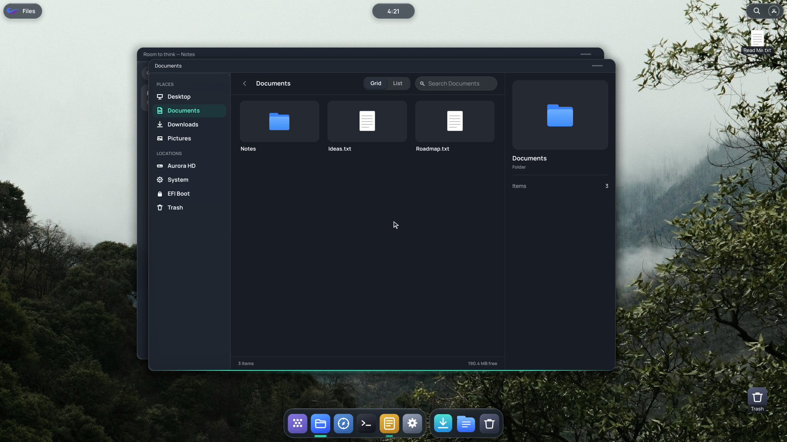 | 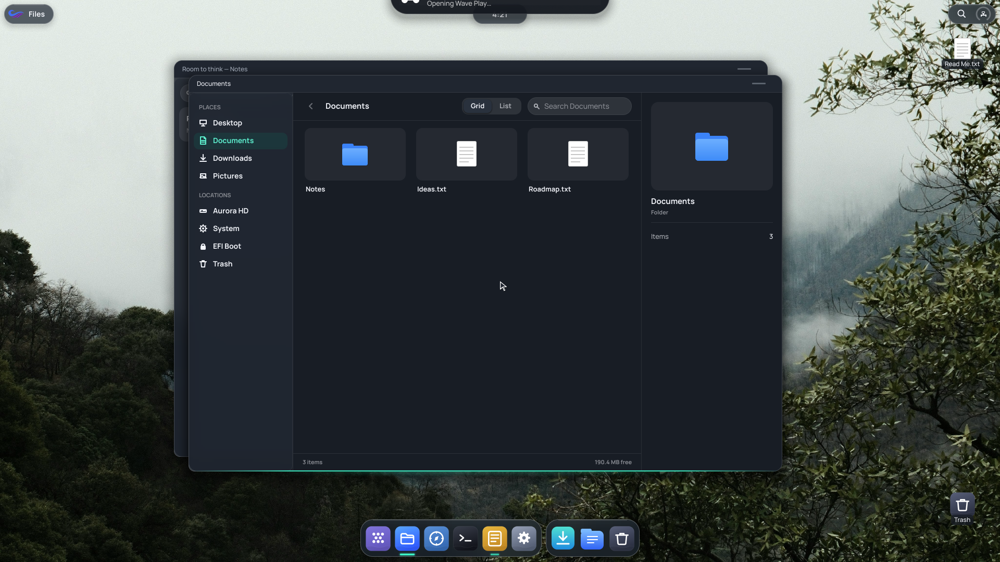 |
| 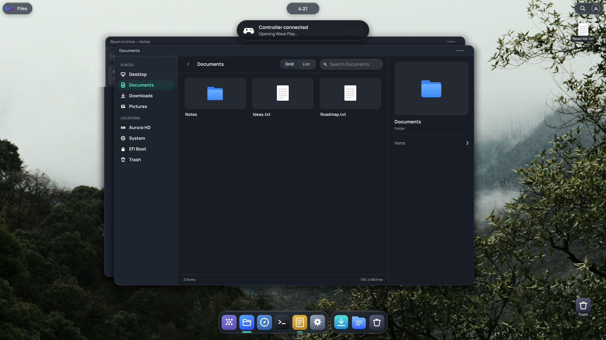 | 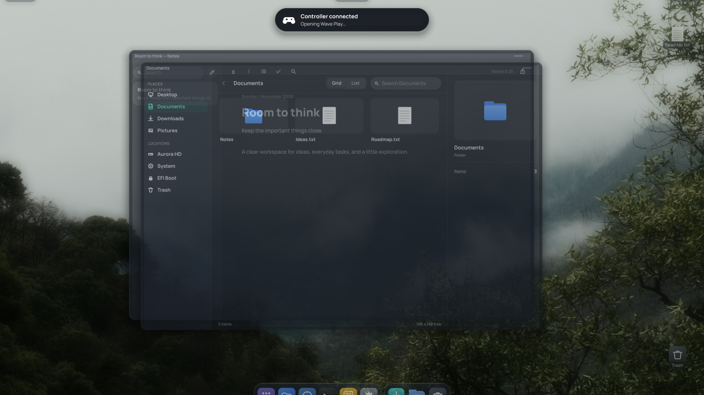 |
| 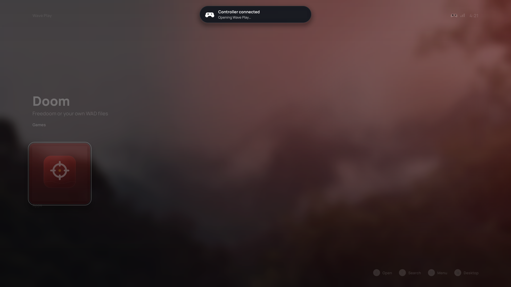 | 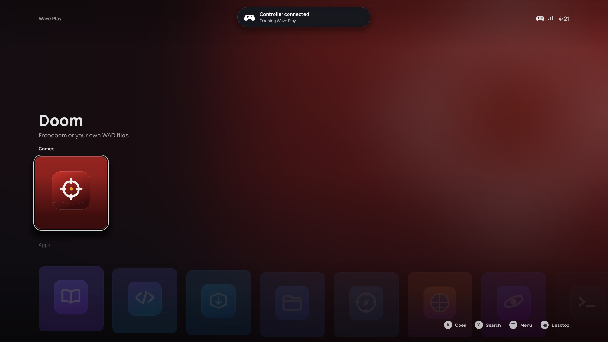 |
| 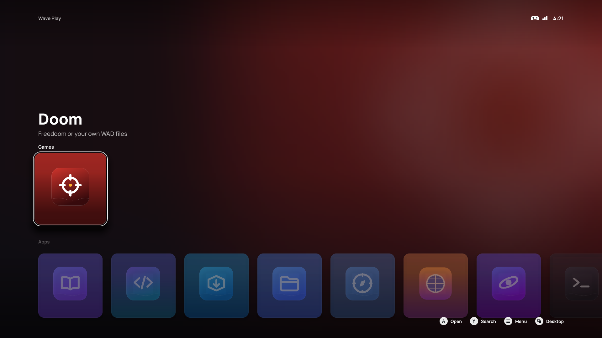 | 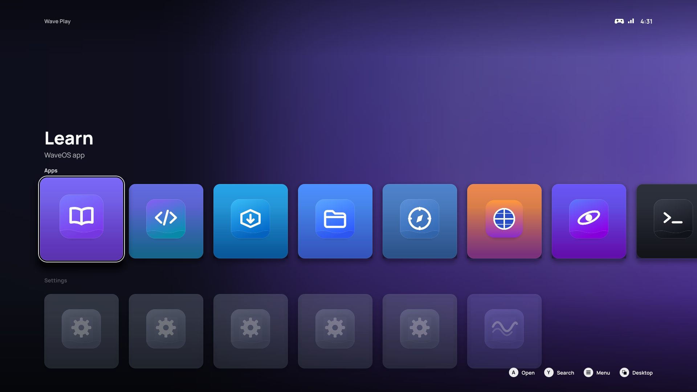 |
| 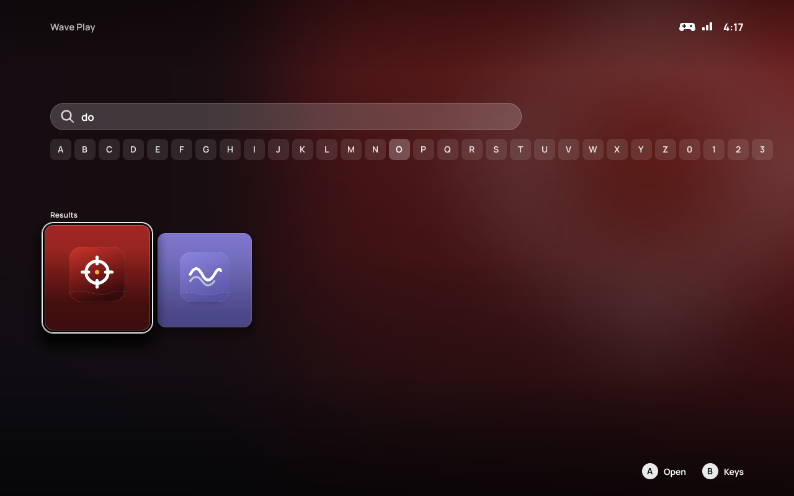 | 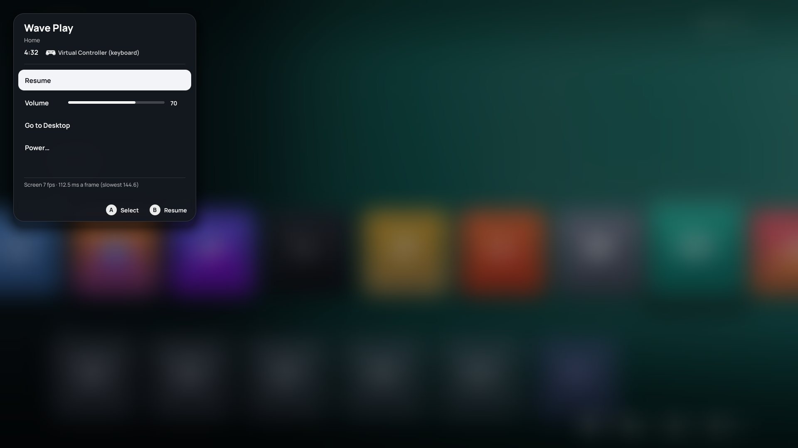 |
| 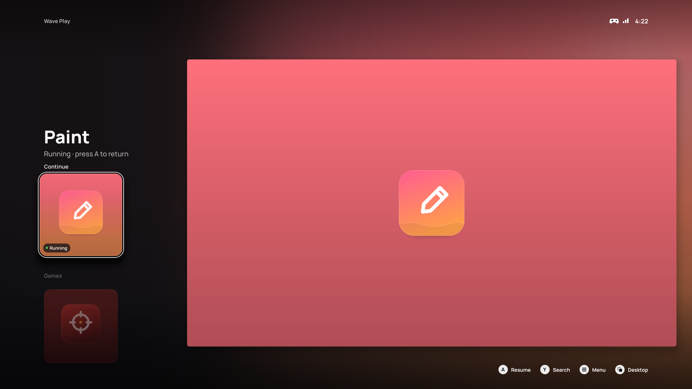 | 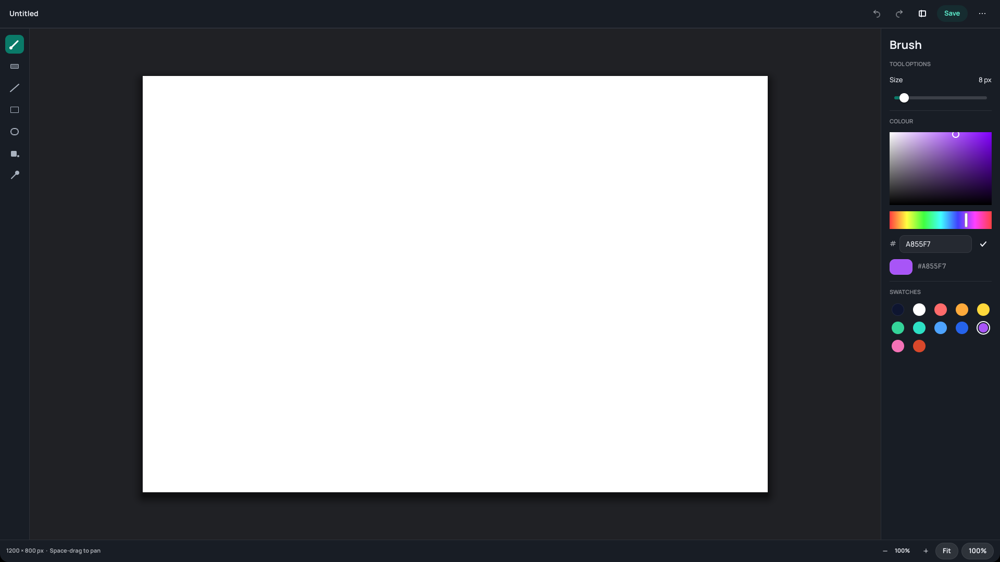 |
| 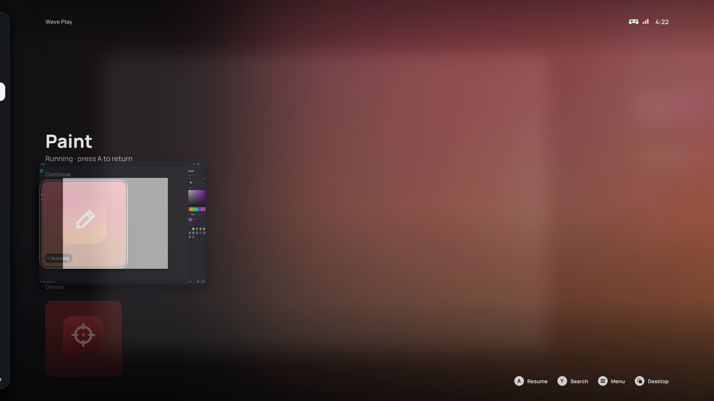 | 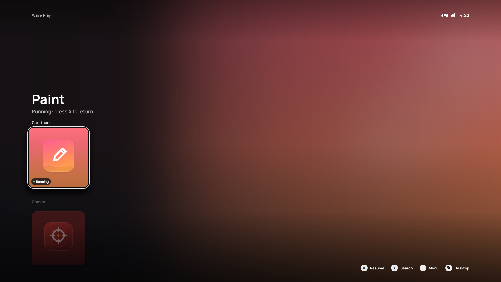 |
| 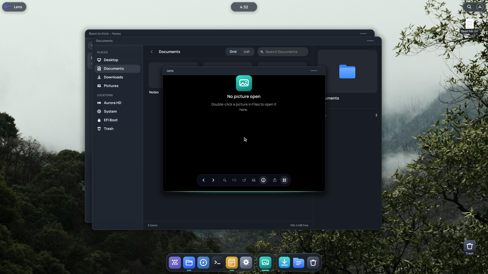 | 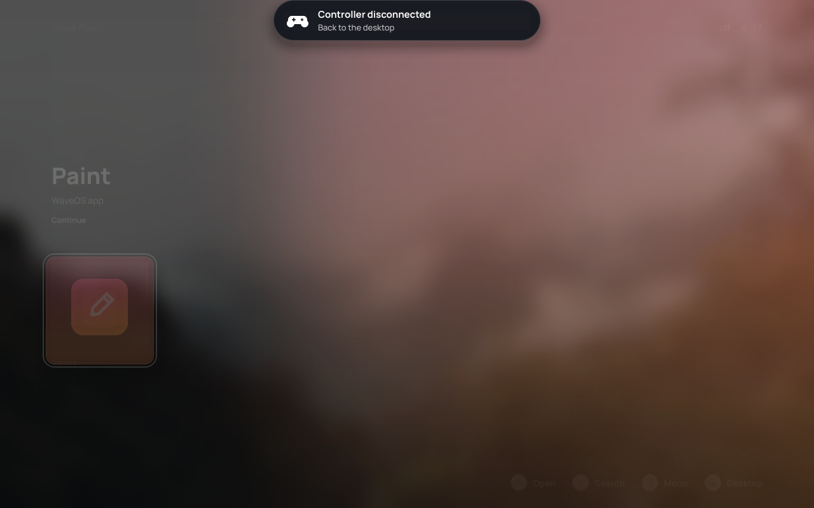 |

## Limits

- This Mac's QEMU has no `usb-redir`, so no USB controller was attached:
  everything above ran through the keyboard controller (Super+G), which
  registers with the same gamepad layer and goes through the same code from
  `gamepad::update` on. The USB paths (HID pads, Xbox 360/One vendor
  protocol, rumble reports) are the existing drivers, unchanged; their
  interaction with Wave Play (hot-plug, glyph families, rumble on focus and
  launch) is untested on real hardware.
- Doom reads controllers natively now, but wasn't played (no game data on
  the test disk). Linux games and Steam tiles weren't exercised (no Linux
  packages on the test disk); Steam itself needs evdev/hidraw to see
  controllers, which WaveOS doesn't provide yet.
- Brightness is omitted from the overlay: WaveOS has no backlight control yet.
- QEMU screendumps can catch a frame half-copied (a horizontal seam); the
  pictures above were chosen without one.
